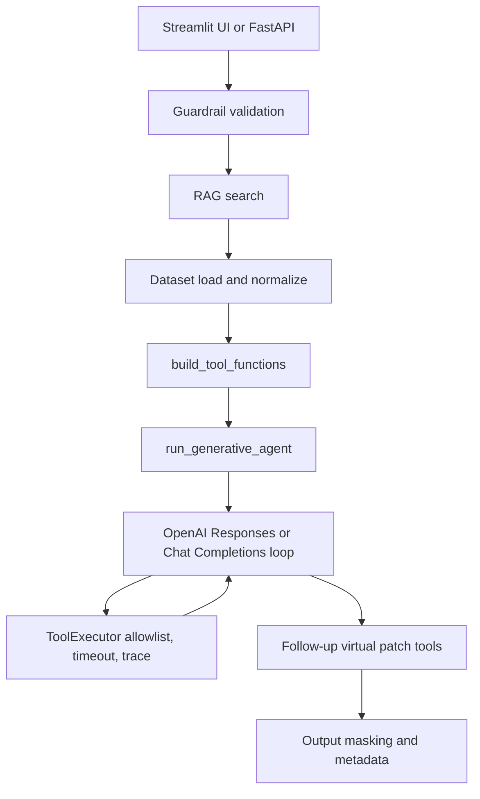

# Agent Architecture

## 현재 구조 분석

- UI 진입점: `app.py`
- API 진입점: `api.py`, `POST /api/agent/run`
- 공통 Agent 실행 함수: `qagent_core.agent.service.run_generative_agent()`
- OpenAI client 생성: `qagent_core.agent.service.create_openai_client()`
- LLM loop:
  - `qagent_core.agent.responses.run_generative_agent_with_responses_api()`
  - `qagent_core.agent.chat_completions.run_generative_agent_with_chat_completions()`
- Tool schema: `qagent_core.tool_registry.TOOL_SCHEMAS`
- Tool 함수 registry: `qagent_core.tools.service.build_tool_functions()`
- Tool 실행 정책: `qagent_core.tool_executor.ToolExecutor`
- 데이터 로딩: `qagent_core.data_io`, `qagent_core.utils`
- 분석 데이터: `data/**/*.csv`, `data/**/README.md`, `data/**/agent_prompt_v2.txt`
- 문서: `README.md`, `docs/**/*.md`
- 테스트: `tests/`, 실행 스크립트 `scripts/`

## 주요 환경변수

- `OPENAI_API_KEY`: 서버 내부 OpenAI 호출 전용.
- `AGENT_API_KEY`: 외부 API 인증 전용.
- `ENABLE_RAG`: 파일 기반 RAG 활성화 여부.
- `RAG_INCLUDE_DATA_DOCS`: 데이터셋 README/prompt/patch-note 검색 포함 여부.
- `RAG_TOP_K`: RAG 검색 결과 개수 제한.
- `MAX_AGENT_QUERY_CHARS`: UI/API query 길이 제한.

## 실행 흐름

## RAG

적용했다. 내부 문서와 데이터셋 설명/패치노트를 근거로 검색해 prompt에 추가하고, API metadata에 출처를 반환한다. 벡터 DB는 도입하지 않았다.

## LangChain

적용하지 않았다. 현재는 OpenAI tool-calling loop, tool registry, prompt builder, trace 구조가 이미 직접 구현되어 있다. LangChain을 도입하면 데모 대비 의존성과 추상화가 늘지만, 현재 이득은 문서 로더 정도에 제한된다.

향후 문서 loader, retriever, prompt template, multi-provider model routing이 커지면 LangChain 도입을 재검토할 수 있다.

## LangGraph

적용하지 않았다. guardrail, RAG, tool selection, LLM loop, follow-up tool 실행은 단계가 있지만 이미 동작 중인 loop와 trace가 있고, LangGraph로 교체하면 회귀 위험이 크다.

대신 API metadata의 `execution_nodes`에 주요 실행 단계를 기록한다. 향후 복수 분기와 재시도 정책이 커지면 다음 node로 그래프화할 수 있다.

API metadata는 `rag_status`, `rag_sources`, `guardrail_warnings`, `execution_nodes`를 포함한다.

- `input_validation`
- `rag_search`
- `rag_context_attached`
- `dataset_load`
- `tool_registry_build`
- `agent_run`
- `output_guardrail`

## MCP

현재는 구현하지 않았다. 과제/데모에서는 로컬 process 안의 Python tool registry가 충분하며, MCP 서버를 분리하면 배포/인증/권한 관리가 늘어난다.

향후 MCP로 분리 가능한 도구:

- 데이터셋 조회 tool
- 패치노트/RAG 검색 tool
- Riot API 수집 tool
- HITL review 저장소 tool
- 밸런스 통계 분석 tool

## A2A

현재는 구현하지 않았다. 단일 Agent가 tool-calling으로 데이터 분석, 가상 패치, 자기검증까지 수행하므로 여러 Agent 간 protocol을 도입할 실익이 작다.

향후 역할 분리 후보:

- 데이터 수집 Agent
- 밸런스 분석 Agent
- 가상 패치 시나리오 Agent
- 검증/리뷰 Agent
- 보고서 작성 Agent

과제 수준에서는 이 구조를 문서화된 확장 설계로만 유지한다.
