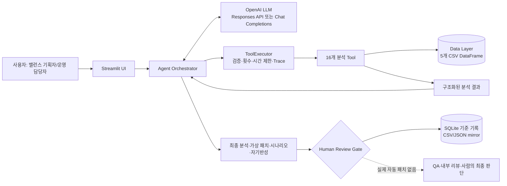
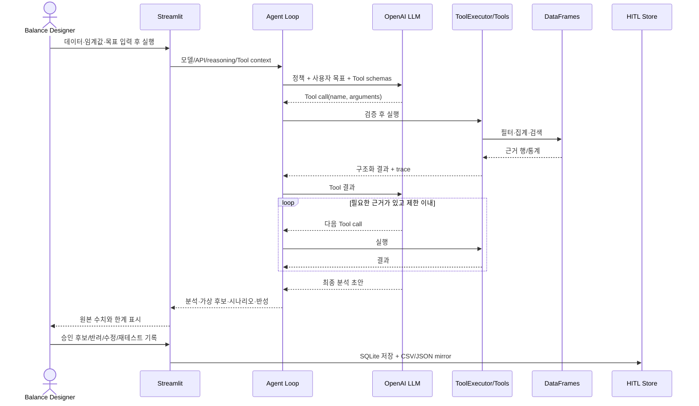
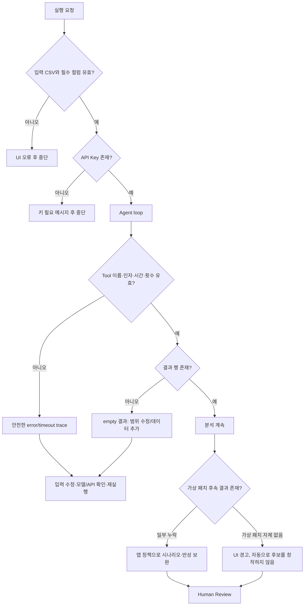

# Game Balance Insight Agent 기술 아키텍처

## 1. 범위와 설계 원칙

이 문서는 QAgent v2.8.0의 실제 구현을 기준으로 한다. 시스템은 경쟁형 온라인 게임의 매치·패치 데이터를 읽고, LLM이 등록된 분석 Tool을 선택하여 근거를 수집한 뒤 분석 초안, 가상 패치 후보, 영향 시나리오와 자기반성을 제시하는 단일 사용자 PoC다. 라이브 게임 설정을 변경하는 기능은 없으며, 최종 단계는 반드시 사람의 검토 기록이다.

제출 기준 최신 구현에는 FastAPI 외부 호출 endpoint, 파일 기반 RAG, 공통 Guardrail이 포함된다. Streamlit UI와 FastAPI는 같은 Agent 실행 서비스를 공유하며, `OPENAI_API_KEY`는 서버 내부에서만 사용한다. 외부 API 인증은 별도 `AGENT_API_KEY`로 처리한다.

구현과 확장을 구분하면 다음과 같다.

| 구분 | 현재 구현 | 운영 확장 필요 |
|---|---|---|
| UI | Streamlit 단일 앱 | 인증, 역할 기반 권한, 조직 배포 |
| 데이터 | 로컬 CSV 5종, 폴더/업로드 | 데이터 웨어하우스, 실시간 파이프라인 |
| Agent | OpenAI Tool calling 반복 루프 | 모델 라우팅, 평가 게이트, 관측성 |
| 분석 | 승률·피해량·시간·세그먼트·패치 비교 | 픽률·밴률·숙련도·상대 조합 통제 |
| 시나리오 | 경계값이 있는 휴리스틱 추정 | 인과 모델, 게임 엔진/샌드박스 검증 |
| 승인 | SQLite 기준 저장, CSV/JSON 호환 출력 | 중앙 감사 저장소, 전자결재, 접근 통제 |

## 2. 전체 아키텍처

원본 Mermaid 파일은 `diagrams/architecture.mmd`에 있다.

## 3. 컴포넌트 책임

### 3.1 Streamlit UI

`app.py`가 데이터 연결, 모델·reasoning·API 방식, 탐지 임계값, 프롬프트, 실행 버튼, Tool Trace, 결과와 HITL 폼을 한 화면 흐름으로 제공한다. 데이터 연결 방식은 `기본 샘플 데이터`, `LoL 데이터`, `폴더에서 자동 연결`, `CSV 직접 업로드` 네 가지다.

UI에는 서버 OpenAI API key 원문 입력창이 없다. 사이드바에는 key 원문 대신 설정됨/미설정 상태만 표시된다. Agent 실행 전 `qagent_core/guardrails.py`가 입력을 검증하고, RAG가 활성화되어 있으면 내부 문서 출처가 실행 결과 metadata와 UI 보조 표시로 연결된다.

모델 선택 목록은 `gpt-5.4`, `gpt-5.4-mini`, `gpt-5.5`, `gpt-5.5-mini`, `gpt-4.1`, `gpt-4.1-mini`, `gpt-4o-mini`, `직접 입력`이다. 이는 UI에 노출된 문자열이며 실제 사용 가능 여부는 계정과 API 제공 상태에 달려 있다. reasoning은 `none`, `minimal`, `low`, `medium`, `high`, `xhigh`를 선택한다. 자동 API 모드는 gpt-5 계열 또는 reasoning 사용 시 Responses API를 선택하고, 그 외에는 Chat Completions를 사용할 수 있다.

### 3.2 Agent Orchestrator

`qagent_core/agent/service.py`가 API 경로를 선택한다. `responses.py`와 `chat_completions.py`는 LLM 응답에서 Tool 요청을 추출하고, 결과를 다시 모델에 전달하는 반복 루프를 구현한다. 기본 제한은 반복 18회, Tool 30회, 180초이며 환경변수로 조정한다.

`api.py`는 `POST /api/agent/run`을 제공한다. 요청은 `Authorization: Bearer <AGENT_API_KEY>` 또는 `X-API-Key`로 인증한다. API request schema와 Guardrail은 빈 query, 너무 긴 query, 잘못된 model 이름, 지원하지 않는 `reasoning_effort`, 과도한 `context`를 차단한다.

`qagent_core/rag.py`는 별도 벡터 DB 없이 파일 기반 검색을 수행한다. 검색 대상은 `README.md`, `docs/**/*.md`, `data/**/README.md`, `data/**/agent_prompt_v2.txt`, `data/**/patch_notes.csv`다. 검색된 내용은 비신뢰 근거 자료로 prompt에 첨부되며, 문서 안의 지시문은 시스템 지시문으로 취급하지 않는다.

API 응답 metadata는 `rag_status`, `rag_sources`, `guardrail_warnings`, `execution_nodes`를 포함한다.

LangChain, LangGraph, MCP, A2A는 현재 제출 코드에는 도입하지 않았다. 기존 tool-calling loop와 registry가 안정적으로 동작하고 있어, 과제 제출 범위에서는 추가 프레임워크보다 문서화된 확장 설계가 적절하다고 판단했다.

관련 환경변수는 `ENABLE_RAG`, `RAG_INCLUDE_DATA_DOCS`, `RAG_TOP_K`, `MAX_AGENT_QUERY_CHARS`다.

시스템 프롬프트는 추측 금지, Tool 근거 의무, 자동 패치 금지, 데이터에 없는 픽률·밴률 생성 금지, 통계적 후보와 확정 판정의 구분을 명시한다. 가상 패치노트가 생성됐지만 후속 호출이 빠졌으면 앱 레벨 정책이 `simulate_virtual_patch_impact`와 `reflect_on_virtual_patch`를 보완 실행한다.

### 3.3 Tool 실행 계층

`ToolExecutor`는 이름과 인자 검증, 호출 수·deadline 확인, 예외의 안전한 메시지 변환, 실행 시간 측정, 민감 정보가 제거된 Trace 기록을 담당한다. 각 결과는 `status`가 있는 구조화 딕셔너리로 반환된다.

호출 가능한 Tool은 코드 기준 16개다.

| 분류 | Tool | 역할 |
|---|---|---|
| 데이터 | `get_dataset_overview` | 행 수, 패치, 전체 승률·피해량, 컬럼 개요 |
| 집계 | `get_team_performance` | 캐릭터/대표 아이템/포지션/티어/패치별 성능 |
| 탐지 | `detect_anomalies` | 표본·승률 차·Wilson 구간·FDR 기반 검토 후보 |
| 패치 | `compare_patch_performance` | 대상의 패치 버전별 승률·피해량·시간 비교 |
| 패치 | `analyze_patch_impact` | 전후 승률·피해량·시간 변화 |
| 세그먼트 | `analyze_segment_performance` | 티어/사용자 구간별 성능 차이 |
| 검색 | `retrieve_related_knowledge` | 캐릭터·스킬·장비·패치 관련 행 검색 |
| 지식 | `retrieve_lol_stat_knowledge` | 내장 스탯 공식 지식 검색 |
| 계산 | `calculate_lol_stat_formulas` | 방어·유효 체력·스킬 가속 등 공식 계산 |
| 근사 | `simulate_stat_impact` | 입력 스탯 변화의 피해량 영향 근사 |
| 조정 | `calculate_adjustment_options` | 완전 롤백이 아닌 부분 조정 후보 |
| 위험 | `assess_balance_risk` | 규칙 기반 위험 점수·등급 |
| 검증 | `generate_retest_plan` | 세그먼트별 재테스트 수와 검토 단계 |
| 후보 | `generate_virtual_patch_note` | 실제 반영 없는 구조화된 가상 패치 후보 |
| 시나리오 | `simulate_virtual_patch_impact` | 보수/기준/공격적 휴리스틱 영향 범위 |
| 반성 | `reflect_on_virtual_patch` | 과조정·표본·세그먼트 부작용 재검토 |

### 3.4 데이터 계층

한 분석 컨텍스트가 다음 DataFrame 5개를 공유한다.

| 파일 | 핵심 내용 |
|---|---|
| `battle_logs.csv` | 참가자 단위 매치 결과, 패치, 캐릭터, 대표 아이템, 포지션, 티어, 피해량, 시간 |
| `characters.csv` | 캐릭터 기본 정보와 스탯 |
| `skills.csv` | 스킬 슬롯, 효과, 재사용 대기시간, 설명 |
| `equipment_sets.csv` | 아이템 유형, 가격, 스탯, 효과 |
| `patch_notes.csv` | 버전, 대상, 변경 설명·유형·전후 값 |

기본 프로토타입 데이터는 1,042개 고유 경기에서 나온 10,420개 참가자 행이다. 앱은 Riot 원본 game version을 분석용 patch version으로 정규화하고 마스터 테이블 컬럼을 표준화한다. Agent 실행 중 원본 CSV를 수정하지 않는다.

## 4. 실행 및 데이터 흐름

## 5. Human-in-the-loop 개입 지점

1. 실행 전: 사용자가 데이터 범위, 임계값과 분석 목표를 정한다.
2. 실행 중 관찰: Tool Trace로 선택한 Tool, 안전 처리된 입력·결과, 성공 여부와 시간을 확인한다.
3. 결과 검토: 최종 분석과 구조화된 가상 패치, 시나리오, 자기반성을 원본 지표와 대조한다.
4. 의사결정: `Pending`, `Approve Virtual Patch`, `Reject Virtual Patch`, `Needs Revision`, `Retest Required`, `Save as Candidate` 중 하나를 사람이 선택한다.
5. 후속 조치: 모니터링, 추가 데이터 수집, 재테스트, 후보 승인 기록, 거절 기록, 재작성, 재실행 등을 지정한다.

`Approve Virtual Patch`는 라이브 패치 적용이 아니라 “후보안 승인 기록”이다. 실제 반영 전 QA와 내부 리뷰는 앱 외부의 조직 절차다.

현재 UI는 상태를 기록하지만 역할별 권한이나 상태 전이 규칙을 강제하지 않는다. 운영 확장 시에는 고위험·Tool 실패·표본 미달 결과를 승인 불가로 처리하고, 분석가 검증과 QA 완료를 별도 서명으로 남기는 정책 엔진이 필요하다.

## 6. 실패 처리 흐름

API 오류, 제한 초과, 잘못된 인자와 데이터 없음은 확정 분석으로 숨기지 않는다. 다만 현재 PoC에는 작업 큐, 자동 재시도, 장애 알림, 중앙 모니터링은 없다.

## 7. 출력 계층

- 실시간 진행 로그와 Tool 호출 수
- Tool별 입력·출력 요약, 성공/실패, 소요 시간, 안전 처리된 JSON
- Markdown 최종 분석
- 가상 패치노트와 구조화 JSON
- 현재/시나리오 승률·평균 피해량 및 민감도 범위
- 자기반성의 긍정 근거·우려·권고
- HITL 검토 레코드와 다운로드 가능한 로그

출력의 “신뢰도”는 휴리스틱 규칙이 생성한 수준 표기이며 확률적으로 보정된 예측 신뢰도가 아니다. 실제 패치 결과를 예측했다는 의미로 해석해서는 안 된다.
