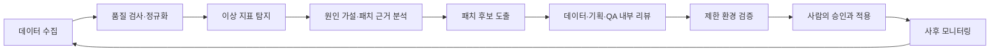
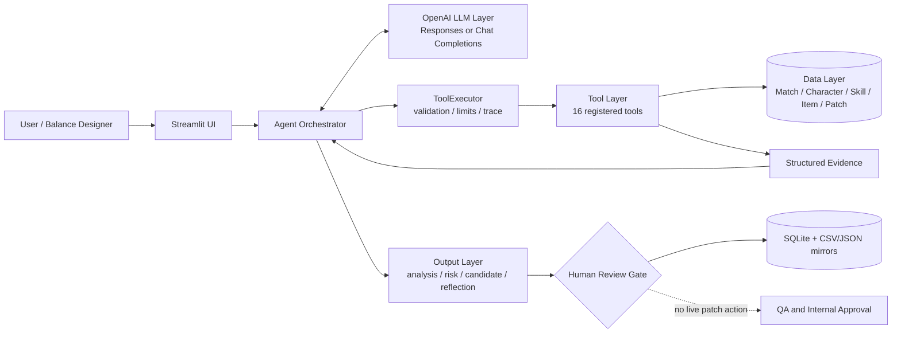
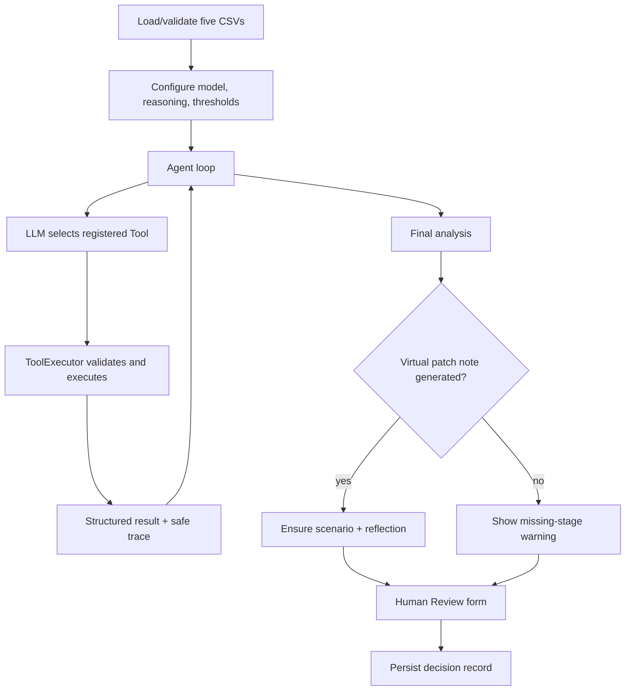

# 게임 라이브 서비스 밸런스 분석을 위한 AI Agent 도입 전략 및 Delivery 설계

**MVP:** Game Balance Insight Agent  
**프로토타입:** QAgent v2.8.0  
**작성 기준일:** 2026년 7월 8일

---

## 초록

라이브 서비스 게임은 출시 후에도 플레이 데이터, 패치 결과와 사용자 반응을 지속해서 관찰하고 조정해야 한다. 특히 경쟁형 온라인 게임의 밸런스 문제는 공정성 인식과 플레이 경험에 직접 연결되며, 장기적으로 이탈, 커뮤니티 신뢰, 콘텐츠와 e스포츠 생태계에도 영향을 줄 수 있다. 그러나 밸런스 담당자의 업무는 단일 승률을 확인하는 것으로 끝나지 않는다. 표본 수, 티어, 캐릭터·아이템·포지션 조합, 패치 전후 변화, 변경 이력과 품질 검증 결과를 함께 해석해야 한다.

본 보고서는 이 반복적이면서도 판단 집약적인 업무에 AI Agent를 도입하는 전략과 Delivery 구조를 제안한다. MVP인 **Game Balance Insight Agent**는 Streamlit UI에서 로컬 매치·마스터·패치 CSV를 연결하고, OpenAI Tool calling([A1])을 통해 통계 분석과 관련 지식 조회 Tool을 선택한다. 결과는 밸런스 “확정 판정”이 아니라 추가 검토 후보, 근거, 부분 조정 후보, 재테스트 계획으로 제공된다. 가상 패치 영향은 예측 모델이 아닌 경계값이 설정된 휴리스틱 민감도 시나리오이며, Agent 자기반성과 Human-in-the-loop(HITL) 검토를 거친다.

프로토타입 검증에는 공개적으로 이해하기 쉬운 경쟁형 온라인 게임 데이터를 사용했다. 이는 특정 게임의 공략이나 자동 패치 결정을 목적으로 하지 않는다. 본 과제의 초점은 데이터 탐색, 패치 영향 검토, 설명 가능한 근거 제시, 위험 통제와 사람의 최종 책임을 하나의 Agent 업무 흐름으로 설계하는 데 있다.

제출 기준 최신 구현은 Streamlit UI뿐 아니라 FastAPI 외부 호출 endpoint도 포함한다. `POST /api/agent/run`은 `AGENT_API_KEY`로 인증하고, UI/API 공통 Guardrail이 입력을 검증한다. 또한 파일 기반 RAG가 내부 문서와 데이터 설명 파일을 검색해 prompt 근거로 첨부하며, API metadata에는 `rag_status`, `rag_sources`, `guardrail_warnings`, `execution_nodes`가 포함된다. `OPENAI_API_KEY`는 서버 내부 OpenAI client 생성에만 사용되며 UI/API/log에 원문을 노출하지 않는다.

**주요어:** 라이브 서비스, 게임 밸런스, AI Agent, Tool calling, Human-in-the-loop, 패치 영향, 위험 관리

---

## 목차

1. 주제 선정 배경  
2. 산업 및 업무 특성 분석  
3. 현재 AI 도입 현황  
4. 향후 AI Agent 도입 후보 10개  
5. MVP Agent 선정 이유  
6. Agent 사용자 시나리오  
7. 필요한 데이터와 도구  
8. 기술 아키텍처  
9. Human-in-the-loop 설계  
10. 위험 요소 및 통제 방안  
11. 평가 지표  
12. 프로토타입 및 데모 설명  
13. 기대 효과와 한계  
14. 결론  

---

## 1. 주제 선정 배경

### 1.1 라이브 서비스와 지속적 밸런스 운영

게임 산업, 특히 온라인 경쟁 게임은 판매 시점에 완성된 제품을 한 번 전달하는 구조와 다르다. 출시 후에도 신규 콘텐츠, 이벤트, 경제 시스템, 캐릭터와 아이템 변경, 버그 수정이 반복된다. 패치가 기존 전략과 사용자 행동을 바꾸고, 그 변화가 다시 다음 패치의 입력이 된다. 따라서 밸런스 운영은 일회성 튜닝이 아니라 **관찰–가설–변경–검증**의 순환 업무다.

경쟁형 게임에서 밸런스 문제는 단순히 한 대상의 승률이 높다는 의미로 끝나지 않는다. 유저는 대전의 공정성과 자신의 선택이 결과에 영향을 준다는 감각을 기대한다. 특정 전략이 지나치게 지배적이거나 대응 가능성이 낮다고 인식되면 실제 통계와 별개로 경험 품질과 커뮤니티 반응이 악화될 수 있다. 반대로 표본이 작거나 일부 숙련자에게만 집중된 현상을 전체 문제로 해석하면 불필요한 조정으로 다른 구간의 경험을 훼손할 수 있다.

### 1.2 현재 업무의 어려움

밸런스 담당자는 승률, 픽률, 밴률, 티어별 성능, 패치 전후 변화, 플레이 시간, 유저 반응, QA 결과를 종합해야 한다. 이 가운데 현재 프로토타입은 승률, 피해량, 전투 시간, 티어/세그먼트와 패치 변경 근거를 사용하며 픽률·밴률은 산출하지 않는다. 산업의 필요 지표와 MVP의 구현 범위를 구분하는 것이 중요하다.

업무에는 반복 가능한 계산과 맥락적 판단이 섞여 있다. CSV를 불러와 그룹별 지표를 계산하고 문서에서 변경 이력을 찾는 일은 자동화하기 쉽다. 그러나 “높은 수치가 실제 조정 대상인가”, “패치와 변화 사이에 인과관계가 있는가”, “어느 구간을 보호해야 하는가”는 데이터 품질과 기획 의도를 아는 사람이 판단해야 한다. 단순 대시보드는 수치를 보여주지만 질문에 맞춰 여러 근거를 연결하고 검토 문서를 만드는 데 한계가 있다.

### 1.3 AI Agent 적용 가설

AI Agent는 자연어 목표를 받아 데이터 조회·통계·검색 Tool을 순차적으로 선택하고, 결과를 설명과 문서 초안으로 결합할 수 있다. 적절히 제한하면 다음을 지원할 수 있다.

- 데이터 규모와 품질을 먼저 확인한다.
- 임계값과 통계 기준에 따라 추가 검토 후보를 찾는다.
- 패치 전후와 티어/세그먼트 차이를 확인한다.
- 마스터 데이터와 패치노트에서 관련 근거를 찾는다.
- 부분 조정 후보와 가정 기반 영향 범위를 작성한다.
- 자신의 분석 한계와 재테스트 조건을 제시한다.
- 결과를 사람의 검토·승인 기록으로 넘긴다.

이 접근의 목표는 AI가 패치를 결정하는 것이 아니다. **반복 탐색과 초안 작성을 줄이고, 사람이 확인할 근거와 불확실성을 더 명시적으로 제시하는 것**이다. 리그오브레전드 데이터는 이 업무 흐름을 검증할 수 있는 공개적이고 구조화된 경쟁형 게임 데이터 예시일 뿐이며, 최종 주제는 게임 산업의 라이브 서비스 밸런스 분석이다.

---

## 2. 산업 및 업무 특성 분석

### 2.1 산업 구조

라이브 서비스 게임은 개발, 퍼블리싱, 플랫폼, 데이터 인프라, 고객 지원, 커뮤니티, e스포츠와 콘텐츠 제작이 연결된 서비스 체계다. 업데이트 속도와 안정성 사이에 긴장이 존재한다. 신규 콘텐츠가 없으면 참여가 약해질 수 있지만, 잦고 검증되지 않은 변경은 학습 비용과 불신을 만든다. 밸런스 팀은 단순 수치 조정 부서가 아니라 기획 의도, 플레이 데이터, QA 재현 결과와 사용자 기대 사이를 조정한다.

수익 모델은 게임별로 다르지만, 라이브 운영에서는 장기 참여와 서비스 신뢰가 중요하다. 밸런스 분석은 매출을 직접 최적화하는 기능으로 좁게 보아서는 안 된다. 공정성, 접근성, 전략 다양성, 신규·숙련 사용자 경험을 함께 고려해야 하며, 수익 지표가 특정 집단의 불리함을 정당화해서는 안 된다.

### 2.2 주요 이해관계자

| 이해관계자 | 주요 관심 | Agent가 지원할 수 있는 정보 | 최종 책임 |
|---|---|---|---|
| 유저 | 공정성, 재미, 예측 가능한 규칙 | 직접 사용자가 아니라 집계 분석의 대상 | 플레이 경험에 대한 피드백 |
| 게임사·리드 | 서비스 안정성과 장기 성과 | 위험 요약, 검토 이력 | 출시·운영 정책 승인 |
| 게임 기획자 | 설계 의도와 전략 다양성 | 지표·패치 근거, 조정 후보 | 설계 방향 결정 |
| 밸런스 디자이너 | 수치 범위와 상호작용 | 후보 탐지, 세그먼트·패치 비교 | 조정안 작성·판단 |
| 데이터 분석가 | 정의, 품질, 통계 타당성 | 계산 Trace, 표본·신뢰구간 | 데이터 검증·분석 설계 |
| QA | 재현성, 회귀 위험 | 재테스트 계획과 실패 조건 | 테스트 수행·통과 판단 |
| 커뮤니티·CS | 체감 이슈와 설명 가능성 | 향후 반응 요약·문서 초안 | 커뮤니케이션 검토 |
| e스포츠·콘텐츠 생태계 | 메타 안정성, 관전성과 일정 | 구간·버전별 영향 요약 | 별도 운영 정책 |

### 2.3 주요 업무 프로세스



1. **데이터 수집:** 매치, 계정 구간, 캐릭터·아이템 사용, 패치와 버그 데이터를 확보한다.
2. **품질 검사:** 중복, 누락, 버전 표기와 지표 정의를 점검한다.
3. **이상 탐지:** 절대 임계값, 평균 차이, 신뢰구간과 다중 비교 통제로 후보를 좁힌다.
4. **원인 분석:** 패치 전후, 티어, 포지션, 아이템, 변경 이력과 QA 결과를 연결한다.
5. **후보 도출:** 부분 조정, 모니터링, 추가 수집, 재테스트 등의 선택지를 만든다.
6. **내부 리뷰:** 분석가가 통계를, 기획자가 의도를, QA가 재현성과 회귀 위험을 검토한다.
7. **적용과 사후 모니터링:** 승인된 변경만 배포하고 동일 지표와 부작용을 관찰한다.

### 2.4 반복·문서·판단 업무의 구분

| 업무 성격 | 예시 | 자동화 적합성 | 사람 개입 이유 |
|---|---|---:|---|
| 반복 계산 | 그룹 집계, 전후 변화율, 표본 검사 | 높음 | 정의·데이터 오류 확인 |
| 반복 검색 | 패치노트·마스터 테이블 관련 행 | 높음 | 검색 결과의 관련성 판단 |
| 문서 초안 | 분석 요약, 검토 카드, 재테스트 계획 | 중간~높음 | 표현·정책·근거 승인 |
| 이상 해석 | 수치가 설계 의도와 충돌하는지 | 중간 | 맥락·교란변수·경험 고려 |
| 패치 결정 | 조정 대상·폭·시점 결정 | 낮음 | 높은 영향과 책임 소재 |
| 라이브 반영 | 배포와 롤백 | 매우 낮음 | 권한·QA·운영 통제 필수 |

### 2.5 주요 데이터

- **매치 데이터:** 결과, 시간, 피해량, 캐릭터·아이템·포지션과 버전.
- **티어/구간 정보:** 성능 차이가 특정 숙련도 구간에 집중되는지 확인.
- **캐릭터·아이템·스킬 지표:** 변경 원인을 해석할 마스터 데이터.
- **패치노트·변경 이력:** 관찰 변화와 설계 변경의 시간적 연결.
- **커뮤니티 반응:** 체감 문제와 설명 요구. 현재 MVP에는 미구현.
- **버그 리포트·QA 결과:** 밸런스 현상과 결함을 구분. 현재 MVP에는 외부 연동 미구현.

### 2.6 보안·규제·책임 이슈

매치 원본에는 계정 식별자가 포함될 수 있으므로 목적 최소화, 가명처리, 접근 통제와 보존 기한이 필요하다. 미공개 패치 계획은 사업상 민감 정보이며 외부 LLM 전송 범위를 제한해야 한다. 특정 경제 시스템의 취약점이나 보상 구조가 유출되면 악용될 수 있다. 또한 자동화 추천이 특정 티어·지역·플레이 스타일을 체계적으로 불리하게 만들 수 있으므로 데이터 대표성과 영향 평가가 필요하다.

AI 결과에 따른 책임은 모델에 귀속될 수 없다. 데이터 소유자, 분석 검토자, 패치 승인자와 배포 담당자의 역할을 명시하고 감사 가능한 기록을 남겨야 한다. NIST AI RMF와 생성형 AI 프로파일은 정보 무결성, 개인정보, 보안과 Human-AI 구성 위험을 체계적으로 관리하는 참고 틀로 사용할 수 있다([A2], [A3]; 서지정보와 URL은 `REFERENCES.md`).

---

## 3. 현재 AI 도입 현황

게임 산업의 AI 활용은 플레이 봇에 한정되지 않는다. QA, 결함 탐지, 운영 안전, 콘텐츠 제작과 상호작용에서 이미 연구 또는 제품화가 진행되고 있다. 아래는 공식 자료로 확인 가능한 사례이며, 공급자 발표의 기대효과를 독립적으로 검증된 성과로 단정하지 않는다.

| 사례명 | 해결하려는 문제 | 사용 AI 기술 | 실제 사용자 | 기대 효과 | 현재 한계 |
|---|---|---|---|---|---|
| EA SEED의 ML 게임 테스트 연구 [G1] | 대형 게임의 방대한 회귀 테스트와 스크립트 유지 비용 | 강화학습, 모방학습, 에이전트 행동 모델 | QA·연구·개발팀 | 반복 플레이 탐색과 테스트 범위 확대 | 훈련 비용, 상태 공간, 실제 빌드 통합, 사람이 판단하는 재미·품질 대체 불가 |
| Ubisoft Commit-Assistant [G2] | 코드 변경이 결함을 유발할 가능성을 조기에 식별 | 과거 버그·커밋 패턴 기반 머신러닝 | 개발자·코드 리뷰어 | 디버깅 우선순위와 예방적 리뷰 지원 | 프로젝트별 데이터 편향, 오탐/미탐, 프로토타입 결과의 일반화 제한 |
| Xbox Community Sift 기반 모더레이션 [G3] | 유해 텍스트·이미지·행동을 노출 전에 식별 | AI 분류와 사람 검토 결합 | Trust & Safety·운영팀·유저 | 대규모 콘텐츠의 선제적 분류 | 문맥·언어·문화 차이, 이의제기와 사람 감독 필요 |
| NVIDIA ACE [G4], [G5] | 정적인 NPC 대화와 제작 파이프라인의 한계 | LLM, 음성 인식·합성, 애니메이션, RAG·guardrail | 게임 개발자·콘텐츠 제작자·플레이어 | 동적 상호작용과 제작 보조 | 지연, 비용, 안전성, 세계관 일관성, 품질 검수 필요 |
| 데이터 분석 리포트 자동화(대표 활용 방향) | 대시보드 탐색과 반복 보고서 작성 | LLM + Tool calling + 구조화 데이터 | 분석가·운영·기획자 | 질문 중심 탐색, 초안 표준화 | 근거 없는 숫자 생성 위험, 지표 정의와 권한 통제 필요 |

사례에서 얻는 시사점은 세 가지다. 첫째, AI는 반복 범위를 넓히지만 품질 정의를 대신하지 않는다. 둘째, 도메인 데이터와 기존 Tool에 연결할 때 실무적 가치가 생긴다. 셋째, 오탐과 설명 책임 때문에 고위험 의사결정에는 사람의 검토가 유지된다. Game Balance Insight Agent도 이 원칙에 따라 자동 패치 기능을 두지 않는다.

---

## 4. 향후 AI Agent 도입 후보 10개

### 4.1 평가 기준

- **기술 난이도:** 낮음/중간/높음. 모델뿐 아니라 데이터 정규화와 운영 통합을 포함한다.
- **위험도:** 잘못된 결과가 사용자·서비스에 미칠 영향.
- **데이터 접근성:** 조직에서 구조화·권한화된 데이터를 확보하기 쉬운 정도.
- **MVP 적합성:** 짧은 기간에 가치와 통제를 함께 검증하기 쉬운 정도.

### 4.2 후보 비교

| # | Agent 후보 | 대상 사용자 | 해결하려는 문제 | 기대 효과 | 기술 난이도 | 위험도 | 데이터 접근성 | MVP 적합성 |
|---:|---|---|---|---|---|---|---|---|
| 1 | 밸런스 이상 지표 탐지 Agent | 분석가·밸런스 기획자 | 많은 조합에서 검토 대상을 찾기 어려움 | 후보 선별 시간 단축 | 중간 | 중간 | 높음 | 매우 높음 |
| 2 | 패치 영향 예측 Agent | 밸런스·리드 기획자 | 적용 전 부작용 범위 불명확 | 시나리오 비교·검증 질문 구체화 | 높음 | 높음 | 중간 | 중간 |
| 3 | 패치노트 요약·변경점 분석 Agent | 기획·QA·CS | 긴 변경 문서와 영향 대상 연결 | 버전 비교와 공유 속도 향상 | 낮음~중간 | 낮음 | 높음 | 높음 |
| 4 | 유저 피드백·커뮤니티 반응 요약 Agent | 커뮤니티·CS·기획 | 대량 비정형 의견의 반복 분류 | 이슈 주제·감성·대표 사례 정리 | 중간 | 중간~높음 | 중간 | 중간 |
| 5 | QA 버그 리포트 우선순위 Agent | QA·개발 리드 | 중복·심각도·재현성 분류 병목 | triage 초안과 중복 후보 연결 | 중간 | 중간 | 높음 | 높음 |
| 6 | 신규 캐릭터·아이템 성능 리스크 검토 Agent | 시스템·밸런스·QA | 출시 전 상호작용과 극단값 누락 | 테스트 매트릭스와 위험 가설 확대 | 높음 | 높음 | 중간 | 중간 |
| 7 | 티어별 메타 변화 분석 Agent | 밸런스·e스포츠 운영 | 전체 평균이 구간별 문제를 가림 | 구간별 조정·모니터링 정교화 | 중간 | 중간 | 높음 | 높음 |
| 8 | 이탈 위험 유저 세그먼트 Agent | 라이브 운영·CRM | 경험 악화 집단을 늦게 발견 | 선제적 경험 개선 후보 도출 | 높음 | 높음 | 낮음~중간 | 낮음 |
| 9 | CS 문의 자동 분류·답변 초안 Agent | CS·운영 | 반복 문의와 라우팅 지연 | 응답 초안·담당팀 분류 | 중간 | 중간 | 높음 | 높음 |
| 10 | 라이브 운영 리포트 자동 작성 Agent | 운영·리드·경영 | 여러 지표를 정기 문서로 만드는 비용 | 일관된 주간 보고 초안 | 낮음~중간 | 중간 | 높음 | 매우 높음 |

### 4.3 우선순위 해석

1번과 10번은 구조화 데이터와 검토 가능한 산출물이 있어 초기 도입에 적합하다. 3번과 5번도 적용 범위가 명확하다. 반면 2번의 진정한 예측 모델, 6번의 복잡한 상호작용 검증, 8번의 이탈 예측은 데이터 누출·편향·인과 오해 위험이 높다. 현재 MVP는 1번을 중심으로 3번, 7번, 10번의 일부 기능을 결합하고, 2번은 “예측”이 아니라 휴리스틱 시나리오로 제한한다.

비교표의 평가는 단순 기능 수가 아니라 **업무 효과, 데이터 접근성, 구현 가능성, 위험 통제, 검증 가능성**의 균형을 본다. 대상 사용자와 해결 문제는 수요 적합성, 기술 난이도와 데이터 접근성은 delivery 가능성, 위험도는 승인 강도, MVP 적합성은 한 학기 내 검증 가능한 산출물 유무를 뜻한다. 실제 도입 시에는 조직 데이터 보유 현황에 따라 이 등급을 다시 산정해야 한다.

---

## 5. MVP Agent 선정 이유

### 5.1 선정 결과

MVP 이름은 **Game Balance Insight Agent(게임 밸런스 인사이트 Agent)**로 정한다. 대상 사용자는 라이브 서비스 게임의 밸런스 기획자 또는 데이터 기반 게임 운영 담당자다.

### 5.2 선정 근거

| 기준 | 판단 |
|---|---|
| 현재 구현 연결성 | 매치 CSV, 패치노트, 마스터 데이터, 분석 Tool, Streamlit UI와 직접 연결 |
| 업무 구체성 | 데이터 개요 → 후보 탐지 → 패치·세그먼트 분석 → 리포트라는 명확한 흐름 |
| 데이터 접근성 | 공개 API와 로컬 CSV로 PoC 가능; 실무에서는 내부 데이터 계약 필요 |
| 위험 통제 | 라이브 변경 기능 없이 후보·근거·재테스트를 사람에게 전달 |
| 평가 가능성 | Tool 결과와 Trace, fixture 테스트, HITL 기록으로 검사 가능 |
| 확장성 | 커뮤니티, QA, 데이터 웨어하우스와 향후 연동 가능 |

상위 후보를 동일한 5점 척도(5점이 유리함)로 다시 비교하면 선정 논리가 더 분명하다. 위험 통제는 위험이 낮거나 HITL로 격리하기 쉬울수록 높은 점수다. 점수는 본 PoC 범위의 설계 판단이며 산업 전체의 객관적 순위는 아니다.

| 상위 후보 | 업무 가치 | 데이터 접근성 | 현재 구현 연결성 | 위험 통제 용이성 | 검증 가능성 | 합계/25 |
|---|---:|---:|---:|---:|---:|---:|
| 밸런스 이상 지표 탐지 | 5 | 5 | 5 | 4 | 5 | **24** |
| 라이브 운영 리포트 작성 | 4 | 5 | 4 | 4 | 4 | 21 |
| 패치노트 분석 | 4 | 5 | 4 | 4 | 4 | 21 |
| 티어별 메타 분석 | 4 | 4 | 5 | 4 | 4 | 21 |
| 패치 영향 예측 | 5 | 3 | 2 | 2 | 2 | 14 |

따라서 MVP는 검증 가능한 이상 탐지를 중심에 두고, 패치노트·티어 분석과 리포트 초안을 보조 기능으로 결합한다. 실제 예측 모델이 필요한 “패치 영향 예측”은 현재 휴리스틱 시나리오와 명확히 분리한다.

현재 저장소는 매치 지표, 관련 캐릭터·아이템·패치 데이터, 패치 전후와 세그먼트 분석을 제공한다. Agent는 이를 호출해 분석 문서를 만든다. “가상 패치”도 원본 파일이나 게임 설정을 변경하지 않고 후보 레코드만 생성한다. 따라서 담당자의 판단을 대체하지 않으면서 Agent의 핵심 가치인 Tool 선택과 근거 결합을 검증할 수 있다.

프로토타입 데이터의 특정 게임 종속 컬럼은 일반 업무 개념으로 매핑된다. `player_team`은 분석 대상 캐릭터, `equipment_set`은 대표 아이템, `skill_used_most`는 포지션, `user_segment`는 티어 또는 참가자 구간으로 사용된다. 향후 다른 게임에 적용할 때 이 canonical schema와 변환 계층을 교체하면 된다.

---

## 6. Agent 사용자 시나리오

### 6.1 기본 시나리오

1. 담당자가 수집된 매치 데이터와 캐릭터·아이템·스킬·패치 CSV를 준비한다.
2. Streamlit UI에서 데이터 연결 방식, 모델, reasoning, API 방식과 분석 임계값을 선택한다.
3. 기본 업무 지시를 확인하거나 분석 목표를 수정하고 `생성형 AI Agent 실행`을 누른다.
4. Agent가 데이터 규모와 전체 지표를 확인하고 등록된 Tool 중 필요한 것을 선택한다.
5. 최소 표본, 승률 절대 기준, 전체 평균 차이, 95% Wilson 구간과 FDR 보정을 이용해 추가 검토 후보를 찾는다.
6. 패치 전후 승률·피해량·전투 시간과 티어/세그먼트별 차이를 분석한다.
7. 캐릭터·아이템·스킬·패치노트에서 관련 근거를 검색하고 필요한 스탯 공식을 계산한다.
8. Agent가 부분 조정 후보, 위험 등급과 세그먼트별 재테스트 계획을 작성한다.
9. 가상 패치노트 후보와 보수/기준/공격적 영향 시나리오를 생성한다.
10. 자기반성 Tool이 과조정, 표본, 티어별 부작용과 추가 검증 필요성을 제시한다.
11. 담당자는 최종 분석과 Tool Trace의 원본 수치를 대조한다.
12. 검토 폼에서 승인 후보, 반려, 수정, 재테스트 또는 보류 상태와 후속 담당자를 기록한다.
13. 내부 회의와 리포트 초안에 활용하고, 실제 변경 전 별도 QA·승인을 수행한다.

### 6.2 예외 시나리오

- 후보가 없으면 임계값을 임의로 낮춰 결론을 만들지 않고 “현재 조건에서 후보 없음”으로 보고한다.
- 표본이 작으면 조정보다 추가 수집과 재테스트를 우선한다.
- 패치 전후 비교 가능한 버전이 없으면 인과 표현을 피한다.
- 가상 패치노트가 생성되지 않으면 UI가 누락을 경고한다.
- API 또는 Tool 실패는 Trace에 남기고 성공 결과처럼 사용하지 않는다.

---

## 7. 필요한 데이터와 도구

### 7.1 현재 구현 데이터

| 데이터 | 파일·형태 | 현재 용도 |
|---|---|---|
| 매치 데이터 | `battle_logs.csv` | 승패, 표본, 피해량, 시간, 버전, 티어·조합 집계 |
| 캐릭터 정보 | `characters.csv` | 역할·기본 스탯·스킬 연결 |
| 스킬 정보 | `skills.csv` | 슬롯, 효과, cooldown, 설명 검색 |
| 아이템 정보 | `equipment_sets.csv` | 가격·스탯·효과 검색 |
| 패치 이력 | `patch_notes.csv` | 변경 대상·설명·전후 값 검색 |
| 데이터 요약 | `dataset_summary.json` | 행 수, 컬럼, 버전과 품질 검사 문서화 |
| Agent 입력 | UI text area | 자연어 목표와 분석 기준 |
| 사용자 설정 | 환경변수·UI | 모델, API 방식, reasoning, 임계값, 안전 한도 |
| 분석 결과 | 메모리·Trace·HITL 저장 | Markdown, 구조화 Tool 결과, SQLite/CSV/JSON |

제출 데이터 요약은 `battle_logs` 10,420행, 고유 매치 1,042개, 캐릭터 175행, 스킬 845행, 아이템 333행, 패치노트 40,272행과 20개 분석 패치 버전을 기록한다. 필수 앱 컬럼의 null과 중복 검사를 통과했다. 이는 수집 모집단의 대표성이나 인과 타당성을 보장하지 않는다.

### 7.2 현재 구현 기술

| 기술 | 역할 |
|---|---|
| Python | 앱·Agent·분석 로직 |
| Streamlit | 설정, 데이터 연결, Trace, 결과와 HITL UI |
| OpenAI Python SDK | Responses/Chat Completions Tool calling |
| pandas | CSV 로딩, 필터, 집계, 정규화 |
| requests | 레거시 Riot 데이터 수집 유틸리티 |
| python-dotenv | 로컬 환경변수 로딩 |
| SQLite | HITL 기준 저장소 |
| CSV/JSON | 입력과 호환 검토 출력 |
| Riot API 수집 스크립트 | 신규 프로토타입 데이터 수집; 앱 실행에는 필수 아님 |

`requirements.txt`에는 Streamlit, pandas, openai, requests, python-dotenv, FastAPI, uvicorn이 명시돼 있다. NumPy와 별도 시각화 라이브러리를 직접 의존성으로 선언하지 않으며, RAG 벡터 저장소도 현재 구현에는 없다. 현재 RAG는 repository 내부의 `README.md`, `docs/**/*.md`, `data/**/README.md`, `data/**/agent_prompt_v2.txt`, `data/**/patch_notes.csv`를 대상으로 하는 파일 기반 검색이다. 사용 기술의 공식 문서는 [T3]~[T5], 데이터 수집 API의 키·호출 정책은 [T1], [T2]에 연결했다.

### 7.3 확장 가능 도구

- 내부 데이터 웨어하우스와 feature store
- 패치 문서용 권한 통제 RAG
- 커뮤니티·CS·QA 시스템 connector
- 실험 플랫폼과 샌드박스 게임 서버
- 시계열·인과 추론 모델과 drift 모니터링
- 역할 기반 접근 통제, Secret manager, 중앙 감사 로그

이 항목은 향후 개선 방향이며 현재 구현 기능이 아니다.

---

## 8. 기술 아키텍처

### 8.1 전체 구조



### 8.2 계층별 역할

**User/UI Layer.** 사용자가 데이터, 임계값, 모델과 목표를 정한다. UI는 데이터 미리보기, Tool Trace와 결과를 분리해 보여준다.

**Agent Orchestrator.** 시스템 정책과 사용자 목표, Tool schema를 LLM에 제공한다. 모델이 Tool을 선택하면 실행 결과를 다시 전달하고, 충분한 근거가 모이면 최종 설명을 생성한다. API 경로는 Responses와 Chat Completions를 지원한다.

**Tool Layer.** 실제 계산과 검색은 Python 함수가 수행한다. `ToolExecutor`가 호출 횟수, deadline, 인자와 오류를 관리한다. 호출 가능한 16개 Tool은 데이터 개요, 집계, 이상 탐지, 패치 버전 비교·영향·세그먼트 분석, 관련 지식·공식, 스탯 근사, 조정·위험·재테스트, 가상 패치·시나리오·자기반성으로 구성된다.

**Data Layer.** 다섯 CSV를 DataFrame으로 로드하며, 앱 시작 시 마스터 테이블과 패치 버전을 정규화한다. 현재는 실시간 DB가 아닌 메모리 기반 PoC다.

**Output Layer.** 최종 Markdown 분석, 구조화된 가상 패치, 시나리오, 자기반성, HITL 검토 기록을 제공한다. 별도의 일반 리포트 파일 생성 Tool은 없지만 LLM의 최종 Markdown과 검토 artifact가 리포트 초안 역할을 한다.

### 8.3 실행 흐름과 안전 한도



기본값은 최대 Agent 반복 18회, Tool 호출 30회, 180초다. 입력 검증과 시나리오 결과 sanity check가 있으며 오류는 안전한 메시지와 Trace로 노출된다. `generate_virtual_patch_note` 이후 모델이 시나리오 또는 자기반성을 생략하면 앱 정책이 두 단계를 보완한다.

### 8.4 통계와 시나리오의 의미

이상 탐지는 최소 표본과 승률 기준뿐 아니라 95% Wilson 승률 구간과 Benjamini–Hochberg FDR 보정을 사용한다([S1], [S2]). 이는 작은 표본의 불확실성과 다중 비교 오탐을 줄이려는 장치다. 그러나 숙련도, 상대 조합, 선택 편향과 시간 추세를 모두 통제하지 못하므로 후보 탐지로만 사용한다.

가상 패치는 대상 승률과 전체 평균의 차이, 위험 등급, 조정 강도를 이용해 제한된 승률·피해량 변화를 가정한다. conservative 0.5배, baseline 1.0배, aggressive 1.5배의 민감도 범위를 제공한다. 이는 미래의 실제 사용자 행동을 학습한 예측 모델이 아니며, 인과 추론이나 게임 엔진 시뮬레이션도 아니다.

상세 Tool과 실패 흐름은 `AGENT_ARCHITECTURE.md`에 별도로 정리했다.

---

## 9. Human-in-the-loop 설계

### 9.1 원칙

Agent는 분석과 추천을 제공하지만 최종 패치를 결정하지 않는다. 이유는 밸런스 결정이 통계 정확성만으로 정의되지 않고, 설계 의도, 출시 일정, QA 결과, 사용자 커뮤니케이션과 사업상 위험을 포함하기 때문이다.

### 9.2 개입 단계

| 단계 | Agent 역할 | 사람 역할 | 통제 결과 |
|---|---|---|---|
| 분석 전 | 기본 프롬프트·임계값 제시 | 데이터 범위와 목표 승인 | 잘못된 범위 방지 |
| 분석 중 | Tool 선택, 계산·검색, Trace | 호출·근거 관찰 | 설명 가능성·오류 발견 |
| 후보 작성 | 위험·부분 조정·재테스트 초안 | 통계·설계 의도 검토 | 과도한 결론 방지 |
| 가상 시나리오 | 가정과 민감도 표시 | 예측이 아닌 가정으로 해석 | 과신 방지 |
| 최종 Gate | 구조화된 검토 카드 제공 | 승인 후보·반려·수정·재테스트 선택 | 책임 명확화 |
| 적용 전 | 자동 적용 없음 | QA·내부 리뷰·권한자 승인 | 라이브 시스템 보호 |

UI의 검토 상태는 `Pending`, `Approve Virtual Patch`, `Reject Virtual Patch`, `Needs Revision`, `Retest Required`, `Save as Candidate`다. 여기서 Approve는 라이브 반영이 아니라 가상 후보의 승인 기록이다. 검토자, 사람이 판단한 위험, 대상, 후속 액션, 담당자와 의견을 함께 저장한다.

검토가 형식적 클릭으로 끝나지 않도록 상태별 최소 조건을 둔다.

| 상태 | 진입 조건 | 필수 확인·기록 | 다음 단계 |
|---|---|---|---|
| Pending | Agent 실행 완료 | 데이터 범위와 Tool 실패 유무 | 담당자 지정 |
| Save as Candidate | 근거와 대상 식별 가능 | 후보 목적, 데이터 버전, 미해결 한계 | 우선순위 회의 |
| Needs Revision | 근거 누락·가정 과도·대상 불명확 | 수정 사유와 재작성 항목 | Agent/분석 재실행 |
| Retest Required | 표본 부족·티어 부작용·고위험 가능성 | 세그먼트, 필요 표본, 합격·중단 기준 | QA 재테스트 |
| Reject Virtual Patch | 데이터 반증 또는 설계 의도 불일치 | 반려 근거와 재검토 조건 | 보류·대안 작성 |
| Approve Virtual Patch | Tool 오류 없음, 근거 대조, QA 계획 확인 | 검토자·위험·승인 사유 | **후보 승인 기록만**; 별도 내부 결재 |

고위험·Critical 판단, 개인정보 또는 미공개 패치 데이터 포함, 핵심 Tool 실패, 세그먼트 표본 미달 중 하나라도 있으면 바로 승인 상태로 이동하지 않고 `Retest Required` 또는 `Needs Revision`으로 보낸다. 이 규칙은 보고서의 운영 제안이며, 현재 UI가 상태 전이를 강제로 차단하는 기능은 구현하지 않았다.

### 9.3 근거·신뢰도·한계 표시

Tool Trace는 호출 이름, 입력·출력 요약, 상태, 시간과 안전 처리된 JSON을 보여준다. 결과에는 표본과 데이터 범위, 가정, 경고가 포함돼야 한다. 현재 시나리오의 `confidence`는 규칙 기반 표기이며 통계적으로 calibration된 확률이 아니다. 운영화 시에는 다음을 추가해야 한다.

- 분석 기준 시각과 데이터 freshness
- 학습/비학습 데이터 범위와 결측률
- 추천별 근거 행 링크와 계산식
- 보정된 예측 신뢰도 또는 “해당 없음” 표시
- 검토자 역할, 승인 사유, 모델·프롬프트·Tool 버전

자기반성은 Agent가 자신의 후보를 비판하도록 하는 장치다. 긍정 근거와 우려, 수정 제안, 권고를 구조화하지만 동일 모델·규칙 체계의 산출물이므로 독립 검증으로 보아서는 안 된다.

---

## 10. 위험 요소 및 통제 방안

| 위험 요소 | 설명 | 가능성 | 영향도 | 통제 방안 | HITL 필요 |
|---|---|---:|---:|---|---|
| LLM 환각 | Tool에 없는 패치·수치·인과를 생성 | 중 | 높음 | Tool 근거 의무, 숫자 회귀 검사, Trace, 금지 프롬프트 | 필수 |
| 잘못된 데이터 해석 | 상관을 패치 효과로 오해 | 중 | 높음 | 후보 표현, 전후 비교 한계, 분석가 검토 | 필수 |
| 티어·유저군 편향 | 수집 구간이 전체 사용자를 대표하지 않음 | 높음 | 높음 | 세그먼트 분석, 표본 공개, 가중치·대표성 평가 | 필수 |
| 미공개 패치 유출 | 외부 API로 민감 변경안 전송 | 중 | 매우 높음 | 데이터 분류, 비식별·최소 전송, 사내 모델/계약, 접근 통제 | 필수 |
| 개인정보 처리 | 계정 식별자와 행동 로그가 노출 | 중 | 매우 높음 | 가명화, 집계, 보존 기한, 권한·감사, 목적 제한 | 필수 |
| 과도한 자동화 의존 | 추천을 승인처럼 받아들임 | 중 | 높음 | 자동 라이브 액션 금지, 명시적 Gate, 교육·책임 분리 | 필수 |
| 실제 환경과 데이터 차이 | 수집 시점·모드와 라이브 메타가 다름 | 높음 | 높음 | freshness, 모드별 분리, 사후 모니터링, rollback 계획 | 필수 |
| 샘플 부족 | 극단 승률이 작은 표본에서 발생 | 높음 | 중~높음 | 최소 표본, Wilson 구간, 재수집·재테스트 | 필수 |
| API 제한·장애 | 데이터 누락 또는 LLM 실행 실패 | 중 | 중 | rate limit 대응, cache, 오류 상태, 재시도·대체 경로 | 상황별 |
| 커뮤니티 반응 오해석 | 풍자·조직 행동·언어 맥락을 잘못 분류 | 높음 | 중~높음 | 현재 MVP 결과에서 제외, 향후 표본·다국어 검수 | 필수 |
| 다중 비교 오탐 | 많은 조합 중 우연한 극단값 선택 | 중 | 높음 | FDR 보정, holdout 검증, 재현 실험 | 필수 |
| Tool registry 불일치 | 구현 함수와 LLM 노출 schema가 달라 기능 누락 | 중 | 중 | registry 계약 테스트, 단일 source of truth | 개발 검토 |
| 검토 로그 변조·손실 | 감사 이력이 불완전 | 낮음~중 | 높음 | SQLite 기준 저장, 중앙 append-only 저장·백업으로 확장 | 필수 |

위험 등급은 PoC의 상대적 평가다. 실제 조직은 데이터 분류, 지역 법규, 게임 규모와 배포 권한을 반영한 별도 위험 평가를 수행해야 한다.

---

## 11. 평가 지표

### 11.1 Agent 성능 평가

| 지표 | 정의 | 측정 방법 | 예시 목표 |
|---|---|---|---|
| 분석 결과 정확도 | 기준 전문가 분석과 핵심 결론 일치 | blind expert review, precision/recall | 조직 baseline 대비 설정 |
| 지표 계산 정확성 | Tool 수치가 독립 계산과 일치 | 고정 fixture·단위 테스트 | 100% |
| Tool 선택 적절성 | 문제별 필수 Tool 호출·불필요 호출 비율 | 기대 Tool set과 Trace 비교 | 필수 Tool 누락 0 |
| 응답 일관성 | 동일 입력 반복에서 핵심 후보·근거 안정성 | 반복 실행 변동 측정 | 허용 범위 정의 |
| 근거 제시율 | 검증 가능한 주장 중 Tool/데이터 근거가 있는 비율 | 문장 단위 감사 | 95% 이상 목표 |
| 환각 발생률 | Tool에 없는 사실·수치 주장 비율 | 자동 숫자 검사 + 사람 검토 | 0% 목표 |
| 실패 시나리오 감지율 | 표본·누락·timeout을 올바르게 중단/경고 | fault injection | 95% 이상 목표 |
| 한계 언급률 | 표본·교란·시나리오 한계를 명시 | rubric 평가 | 필수 항목 100% |

저장소에는 fixture의 기대 Tool, 금지 주장, 필수 키워드·한계, 지원되지 않는 숫자를 검사하는 `qagent_core/evaluation.py`와 Agent loop·프롬프트·데이터 파이프라인 테스트가 있다. 이는 계산·계약 회귀 검사에 유용하지만 전문가 판단의 정확도를 대체하지 않는다.

핵심 지표의 산식은 다음과 같이 고정한다.

- **근거 제시율** = Tool 결과 또는 데이터 행으로 추적 가능한 검증 주장 수 ÷ 전체 검증 주장 수.
- **환각 발생률** = 근거에 없거나 근거와 충돌하는 사실·수치 주장 수 ÷ 전체 사실·수치 주장 수.
- **Tool 선택 적절성** = 시나리오별 필수 Tool 호출 수 ÷ 기대 필수 Tool 수. 불필요 호출률은 별도로 기록한다.
- **실패 감지율** = 올바르게 경고·중단한 결함 주입 사례 수 ÷ 전체 결함 주입 사례 수.
- **응답 일관성** = 동일 입력 반복에서 동일 Top 후보·핵심 권고가 유지된 실행 수 ÷ 전체 반복 수.

PoC 합격 gate는 계산 fixture 100% 통과, 금지된 자동 승인 주장 0건, 지원되지 않는 숫자 0건, 필수 Tool 누락 0건이다. 근거 제시율 95%와 실패 감지율 95%는 pilot 목표이며 현재 달성 실적으로 주장하지 않는다. 동일 조건 최소 10회 반복과 데이터 누락·timeout·빈 결과 fault injection을 포함해 평가한다.

### 11.2 업무 효과 평가

| 지표 | 정의 | 측정 설계 |
|---|---|---|
| 분석 시간 단축 | 동일 이슈의 데이터 탐색 완료 시간 감소 | Agent 미사용/사용 교차 실험 |
| 리포트 작성 시간 단축 | 검토 가능한 초안까지 걸린 시간 | 작업 로그·문서 타임스탬프 |
| 패치 후보 도출 속도 | 이슈 접수부터 후보·재테스트안까지 시간 | 운영 ticket lead time |
| 담당자 만족도 | 유용성·신뢰·통제감 평가 | 5점 척도 + 인터뷰 |
| 사후 패치 모니터링 정확도 | 실제 부작용을 탐지한 비율과 오탐 | 패치 후 기준 기간 평가 |
| 반복 업무 감소율 | 수동 집계·검색·복사 단계 감소 | task analysis |
| 검토 품질 | 근거 누락·재작업·반려율 변화 | 문서 품질 rubric |

현재 PoC는 업무시간 단축이나 실제 패치 성과를 실험으로 입증하지 않았다. 위 수치는 향후 pilot에서 수집할 평가 계획이다. 초기 4~6주 동안 동일 유형 이슈를 Agent 사용/미사용 조건으로 비교하고, 속도와 품질을 동시에 측정해야 한다. 속도가 빨라져도 환각이나 재작업이 늘면 성공으로 보지 않는다.

업무 pilot의 예시 판정 기준은 분석·리포트 중앙시간 30% 이상 단축, 전문가 품질 점수 비열등(기존 방식 대비 -5%p 이내), 중대 근거 누락 0건, 담당자 만족도 5점 척도 평균 4.0 이상이다. 표본과 조직 baseline을 사전 등록하고 같은 난이도의 업무를 교차 배정한다. 이 수치는 목표값이지 현재 프로젝트의 측정 결과가 아니다.

---

## 12. 프로토타입 또는 데모 설명

### 12.1 프로젝트 구조

```text
QAgent/
├── app.py                    # Streamlit 진입점
├── qagent_core/              # agent, tools, statistics, simulation, review
├── data/                     # 샘플·프로토타입·HITL 데이터
├── tests/                    # 자동 테스트와 fixture
├── scripts/                  # 검사·요약·프로파일 유틸리티
├── docs/                     # 실행·구조·리팩터링·평가 문서
├── report/                   # 기존 보고 산출물
├── requirements.txt
└── .env.example
```

`app.py`는 UI 조립을 담당하고 실제 Agent·Tool·검토 로직은 `qagent_core`에 분리돼 있다. `fetchMatch.py`, `fetchPatches.py`, `build_lol_assignment_dataset.py`, `generateDemoData.py`는 데이터 수집·생성 유틸리티이며 앱이 직접 import하지 않는 레거시/보조 스크립트다.

### 12.2 설치와 실행

PowerShell 기준:

```powershell
cd D:\IdeaProjects\QAgent
pip install -r requirements.txt
Copy-Item .env.example .env
streamlit run app.py
```

필수 환경변수는 Agent 실행용 `OPENAI_API_KEY`다. 외부 API endpoint를 호출하려면 별도 `AGENT_API_KEY`도 필요하다. 포함된 CSV 분석에는 `RIOT_API_KEY`가 필요 없으며 신규 수집 때만 사용한다. `OPENAI_API_KEY`는 서버 내부에서만 사용하고 UI/API/log에 원문을 노출하지 않는다.

| 환경변수 | 기본/예시 | 역할 |
|---|---|---|
| `OPENAI_API_KEY` | 없음 | 필수 LLM 인증 |
| `AGENT_API_KEY` | 없음 | 외부 API endpoint 인증 |
| `RIOT_API_KEY` | 없음 | 신규 데이터 수집 시 선택 |
| `OPENAI_MODEL` | `gpt-5.4` | 기본 모델 문자열 |
| `OPENAI_API_MODE` | `responses` | Responses/Chat Completions 선택 |
| `OPENAI_REASONING_EFFORT` | `none` | reasoning 수준 |
| `MAX_AGENT_ITERATIONS` | 18 | 반복 제한 |
| `MAX_TOOL_CALLS` | 30 | Tool 호출 제한 |
| `AGENT_TIMEOUT_SECONDS` | 180 | 전체 제한 시간 |
| `ENABLE_RAG` | true | 파일 기반 RAG 활성화 |
| `RAG_INCLUDE_DATA_DOCS` | true | 데이터셋 README/prompt/patch note 검색 포함 |
| `RAG_TOP_K` | 4 | RAG 근거 개수 제한 |
| `MAX_AGENT_QUERY_CHARS` | 12000 | UI/API query 길이 제한 |
| `ENABLE_TOOL_TRACE` | true | 상세 Trace 표시 |
| `BALANCE_MIN_SAMPLES` | 30 | 최소 표본 |
| `BALANCE_MIN_WIN_RATE` | 0.75 | 승률 기준 |
| `BALANCE_MIN_WIN_RATE_DIFF` | 0.20 | 전체 평균 차이 기준 |

### 12.3 주요 화면과 정확한 UI 흐름

1. 제목: `Battle Balance Analyst Generative AI Agent v2.8.0`
2. 사이드바: `LLM Agent 설정`, 모델, reasoning, API 방식, 세 임계값.
   - OpenAI API key 원문 입력창은 없고 서버 key 설정 상태만 표시한다.
3. `1. 데이터 입력`: 네 가지 연결 방식과 로드 상태·컬럼·미리보기.
4. `2. Agent 목표 입력`: 기본 업무 지시를 확인·수정.
5. `생성형 AI Agent 실행`: LLM과 Tool loop 시작.
6. `3. 실시간 Agent 실행 상태`: 진행 로그.
7. `4. Agent Tool Call Trace 상세`: Tool별 인자·결과·상태·시간.
   - RAG가 활성화된 경우 source 파일/섹션 metadata가 함께 표시된다.
8. `5. 생성형 AI Agent 최종 분석`: Markdown 분석 초안.
9. `6. Virtual Patch Scenario Estimate & HITL Review Gate`: 후보·시나리오·자기반성·검토 폼.
10. `가상 패치 HITL 검토 로그 저장`: SQLite 및 호환 출력 저장.

### 12.4 모델과 reasoning 설정

UI는 여러 모델명과 직접 입력을 지원한다. 목록에 표시된 모델이 모든 API 계정에서 사용 가능하다는 보장은 없다. API 방식 `자동`은 gpt-5 계열 또는 reasoning이 `none`이 아닐 때 Responses API를 선택하도록 구현됐다. 사용자는 Responses API 또는 Chat Completions를 명시할 수도 있다.

reasoning 옵션은 `none`, `minimal`, `low`, `medium`, `high`, `xhigh`다. 모델이 해당 값을 지원하지 않으면 API 오류가 발생할 수 있다. 데모 기본은 `.env.example`과 `docs/RUN.md` 기준 `gpt-5.4`, Responses API, reasoning `none`이다.

### 12.5 실제 Agent Tool과 출력

현재 `TOOL_SCHEMAS`에 등록돼 LLM이 호출할 수 있는 Tool은 16개다.

1. `get_dataset_overview`
2. `get_team_performance`
3. `detect_anomalies`
4. `compare_patch_performance`
5. `analyze_patch_impact`
6. `analyze_segment_performance`
7. `retrieve_related_knowledge`
8. `retrieve_lol_stat_knowledge`
9. `calculate_lol_stat_formulas`
10. `simulate_stat_impact`
11. `calculate_adjustment_options`
12. `assess_balance_risk`
13. `generate_retest_plan`
14. `generate_virtual_patch_note`
15. `simulate_virtual_patch_impact`
16. `reflect_on_virtual_patch`

Tool 결과는 `status`, 계산 값, 근거 행·가정·경고가 포함된 JSON형 딕셔너리다. UI는 이를 실행 Trace와 요약으로 보여주며, LLM은 최종 분석 Markdown을 작성한다. 현재 별도의 PDF/Word 자동 보고서 생성 기능은 없다.

### 12.6 입력과 출력 예시

입력 목표 예시:

> 최소 30전, 승률 0.75 이상, 전체 평균보다 0.20 이상 높은 조합을 추가 검토 후보로 분석하라. 패치와 티어별 근거를 확인하고, 표본이 부족하면 조정보다 재수집을 제안하라. 데이터에 없는 픽률·밴률은 만들지 말라.

출력의 기대 구조:

- 데이터 규모와 전체 기준
- Top 1~3 추가 검토 후보와 표본·승률·신뢰구간 근거
- 패치 전후와 티어별 차이
- 관련 캐릭터·아이템·패치 행
- 스탯 영향 근사와 한계
- 부분 조정·위험·재테스트 후보
- 가상 패치노트, 민감도 시나리오, 자기반성
- HITL Review Card

실제 후보명과 수치는 실행한 Tool 결과에 따라 달라지므로 보고서에서 고정하지 않는다.

### 12.7 가상 패치와 자기반성 예시

가상 패치 Tool은 대상과 위험 수준, 강도, 현재 성능 차이를 사용해 `nerf`, `buff`, `monitor` 중 방향을 정하고, 다음 분석 버전명을 `-agent-candidate`로 만든다. 결과에는 현재 승률, 전체 평균 차이, 표본, 가정 승률·피해량 변화와 “실제 반영 아님” 문구가 포함된다.

시나리오 Tool은 현재 승률·평균 피해량·시간에 가정 변화량을 적용하고, 보수/기준/공격적 범위를 보여준다. 자기반성은 긍정 근거, 우려, 수정 제안과 `Monitor`, `Needs Revision`, `Retest Required`, `Human Approval Required` 계열의 권고를 제시한다. 예시 문장은 다음과 같이 해석해야 한다.

> “기준 시나리오에서 승률이 감소한다”는 표현은 입력 가정을 산술적으로 적용한 결과이지 실제 패치 후 승률 예측이 아니다. 표본과 티어별 부작용을 확인한 뒤 재테스트해야 한다.

### 12.8 실패 시나리오

- **API 키 없음:** 실행 버튼 후 키가 필요하다는 오류로 중단.
- **CSV/필수 컬럼 누락:** 로드 단계에서 오류·누락 목록 표시 후 중단.
- **후보 없음:** `empty` 또는 후보 없음 결과를 표시하고 임의 결론을 만들지 않음.
- **Tool 미호출:** 명시적 경고와 프롬프트 수정 안내.
- **잘못된 인자·timeout:** Trace에 실패 상태와 안전한 오류를 기록.
- **후속 결과 누락:** 가상 패치가 있으면 시나리오·반성을 앱이 보완; 가상 패치 자체가 없으면 경고.
- **저장 mirror 실패:** SQLite 기준 저장 성공과 CSV/JSON 출력 실패를 구분해 알림.

상세 데모 대본은 `DEMO_SCENARIO.md`에 있다.

---

## 13. 기대 효과와 한계

### 13.1 기대 효과

1. **반복 분석 시간 단축:** 수동 필터·집계·패치 검색을 질문 중심 흐름으로 묶는다.
2. **데이터 기반 의사결정 지원:** 결론과 함께 표본, 변화량, 관련 근거를 제시한다.
3. **패치 전 검토 품질 향상:** 민감도와 실패 조건을 사전에 문서화한다.
4. **리포트 초안 자동화:** 분석 구조와 HITL Review Card를 일관된 형식으로 만든다.
5. **주니어 기획자 보조:** 누락하기 쉬운 통계·한계·재테스트 질문을 안내한다.
6. **팀 간 커뮤니케이션:** 분석·기획·QA가 동일 Trace와 후보 레코드를 검토한다.
7. **감사 가능성:** 모델·Tool 흐름과 사람의 결정 사유를 연결한다.

이 효과는 현재 설계상 기대이며 실제 시간·품질 개선은 11장의 평가 계획으로 검증해야 한다.

### 13.2 현재 한계

- 데이터 품질, 수집 범위와 패치 버전 매핑에 의존한다.
- 실제 패치 결과는 사용자 학습, 메타 적응과 상대 전략 변화에 따라 달라진다.
- LLM 설명과 Tool 선택은 반복 실행에서 달라질 수 있고 사람 검증이 필요하다.
- 한 경쟁형 게임 데이터로 검증했기 때문에 다른 장르·경제 시스템으로 일반화하려면 schema와 정책 실험이 필요하다.
- 픽률·밴률, 숙련도, 상대 조합, 커뮤니티 감성, 버그·QA 시스템은 현재 분석에 통합되지 않았다.
- 휴리스틱 시나리오는 인과 예측 또는 게임 엔진 시뮬레이션이 아니다.
- 로컬 단일 사용자 Streamlit·SQLite PoC이며 인증, 역할 권한, 중앙 모니터링과 고가용성이 없다.
- 외부 LLM에 민감한 내부 패치 데이터를 전송하는 운영 보안 구조가 구현되지 않았다.
- 모델 목록과 API 지원 여부는 외부 서비스 상태와 계정 권한에 따라 달라질 수 있다.

### 13.3 단계적 개선 방향

**1단계—신뢰성 강화:** Tool registry와 프롬프트 정합성, 계산 provenance, 숫자 grounding, 실패 테스트와 평가 dashboard를 강화한다.

**2단계—데이터 확장:** 픽률·밴률, 숙련도, 상대 조합, 패치 exposure, QA 결과를 canonical schema로 연결한다. 개인정보와 권한 분리를 먼저 설계한다.

**3단계—검증 환경:** 샌드박스/게임 엔진 테스트와 제한된 A/B 실험을 연동하고, 사후 결과로 시나리오 calibration을 평가한다.

**4단계—운영화:** SSO, 역할 기반 권한, Secret manager, 중앙 append-only 감사 로그, observability, 비용·latency SLO와 incident 대응을 구축한다.

---

## 14. 결론

본 프로젝트는 특정 게임의 공략 또는 자동 패치 도구가 아니라, **게임 산업의 밸런스 분석 업무에 AI Agent를 적용하는 전략과 MVP Delivery 설계 사례**다. 공개적이고 구조화된 경쟁형 온라인 게임 데이터는 매치·티어·패치 근거가 연결되는 업무 흐름을 검증하기 위한 예시로 활용됐다.

Game Balance Insight Agent는 자연어 목표를 받아 데이터 개요, 이상 후보, 패치와 세그먼트 영향, 관련 지식, 부분 조정·위험·재테스트 Tool을 선택한다. 결과는 근거와 Trace, 가상 패치 후보, 휴리스틱 민감도 시나리오와 자기반성으로 구성된다. AI Agent는 밸런스 담당자의 판단을 대체하지 않는다. 데이터 탐색, 이상 징후 분석, 패치 영향에 대한 가정 정리와 리포트 초안을 보조한다.

산업 적용의 성공 조건은 모델의 유창함보다 **근거가 있는 계산, 구현 범위의 정직한 표시, 실패 처리, 보안과 Human-in-the-loop**에 있다. 고위험 추천은 독립된 데이터 검증과 QA, 내부 리뷰를 거쳐야 하며, 최종 승인과 실제 반영 책임은 사람에게 있다. 이후에는 실제 업무시간과 검토 품질, 환각률, 실패 감지율을 함께 측정하여 Agent가 빠르기만 한 도구가 아니라 더 검증 가능한 의사결정 보조 체계인지 평가해야 한다.

---

## 부록 A. 구현 사실과 향후 제안 구분

| 항목 | 현재 구현 | 향후 제안 |
|---|---|---|
| 데이터 | 로컬 CSV 5종, 폴더·업로드 | 실시간 warehouse·stream |
| 지표 | 승률, 피해량, 시간, 티어, Wilson, FDR | 픽률, 밴률, 숙련도, 상대 조합 |
| 지식 | DataFrame·내장 공식 검색 | 권한 통제 RAG |
| 영향 | 휴리스틱 민감도 시나리오 | 인과 예측·게임 엔진 검증 |
| 결과 | Markdown, JSON Trace, HITL artifact | PDF/Word 자동 보고, dashboard |
| 승인 | 후보 상태를 SQLite에 기록 | 조직 전자결재·배포 gate 연동 |
| 운영 | 로컬 Streamlit PoC | SSO, RBAC, 중앙 감사, 관측성 |

## 부록 B. 재현 명령

```powershell
pip install -r requirements.txt
Copy-Item .env.example .env
streamlit run app.py
python -m unittest discover -s tests -v
python -m py_compile app.py generateDemoData.py build_lol_assignment_dataset.py
python -m compileall -q qagent_core tests
python scripts/check_encoding.py
```

참고문헌과 URL은 `REFERENCES.md`에 수록했다.
