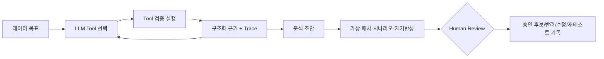
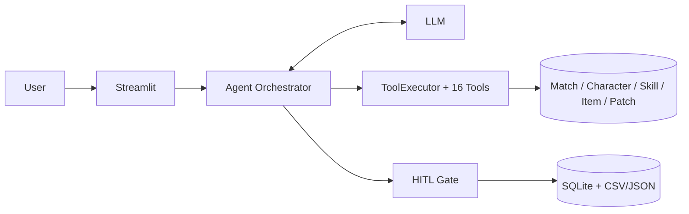

# 게임 라이브 서비스 밸런스 분석을 위한 AI Agent 도입 전략 및 Delivery 설계

> 제출 패키지의 중심 문서는 `FINAL_REPORT.md`, `AGENT_ARCHITECTURE.md`, `DEMO_SCENARIO.md`, `REFERENCES.md`다. 이 파일은 발표가 필요한 상황을 위한 선택 부록이며, 제출물 자체를 대체하지 않는다. 최신 API/RAG/Guardrail 구현 설명은 보고서와 아키텍처 문서를 우선 기준으로 삼는다.

## Slide 1. 제목

- Game Balance Insight Agent
- 플레이 데이터와 패치 근거를 연결하는 밸런스 의사결정 지원 PoC
- 핵심 원칙: 자동 패치가 아니라 Human-in-the-loop 분석 보조

선택 부록 메모:
이 프로젝트는 특정 게임의 공략 도구가 아니다. 경쟁형 온라인 게임에서 반복되는 데이터 탐색, 이상 후보 분석, 패치 검토와 보고 업무를 AI Agent로 보조하는 전략과 구현 사례다. 특정 게임 데이터는 공개적이고 구조화된 프로토타입 검증 자료로만 사용했다.

---

## Slide 2. 문제 배경: 라이브 서비스의 반복적 밸런스 운영

- 출시 후에도 패치, 모니터링, 원인 분석이 계속되는 산업 구조
- 밸런스는 공정성 인식, 플레이 경험, 이탈, 커뮤니티 반응에 연결
- 데이터는 많지만 “무엇이 문제이고 왜 그런가”는 단순 집계만으로 결정하기 어려움

선택 부록 메모:
담당자는 승률뿐 아니라 표본, 티어, 패치 전후 변화, 캐릭터·아이템 변경 이력을 함께 읽어야 한다. 분석은 반복적이지만 패치 결정을 완전 자동화하기에는 맥락과 위험이 크다.

---

## Slide 3. 대상 사용자와 현재 업무 흐름

- 사용자: 라이브 서비스 게임의 밸런스 기획자·데이터 기반 운영 담당자
- 수집 → 이상 탐지 → 원인 분석 → 후보안 → 리뷰·QA → 적용 → 사후 모니터링
- 병목: 도구 간 이동, 반복 집계, 근거 문서 연결, 리포트 초안 작성

선택 부록 메모:
Agent가 맡는 범위는 탐색과 초안이다. 패치 승인, QA 통과, 라이브 적용은 조직의 책임으로 남긴다.

---

## Slide 4. 산업 특성과 이해관계자

- 유저·게임사: 공정성, 재미, 안정적 서비스와 신뢰
- 기획·밸런스·분석·QA: 지표 해석, 재현, 조정 범위와 검증
- 커뮤니티·CS·e스포츠: 반응, 이슈 전달, 메타와 콘텐츠 생태계
- 제약: 개인정보, 미공개 패치 유출, 데이터 편향, 자동 의사결정 책임

선택 부록 메모:
같은 승률 변화도 신규 유저 구간과 상위 티어에서 의미가 다를 수 있다. 이해관계자별 기준을 하나의 숫자로 축소하면 안 된다.

---

## Slide 5. 현재 AI 도입 현황

- EA SEED: 강화학습·모방학습 기반 게임 테스트 연구 [G1]
- Ubisoft Commit-Assistant: 과거 결함 패턴을 이용한 버그 위험 식별 프로토타입 [G2]
- Xbox Community Sift: AI와 사람을 결합한 콘텐츠 모더레이션 [G3]
- NVIDIA ACE: 생성형 AI 기반 대화형·행동형 게임 캐릭터 제작 지원 [G4], [G5]

선택 부록 메모:
사례는 QA, 개발, 운영 안전, 콘텐츠로 분산돼 있다. 공통점은 대량 반복 작업을 보조하되 도메인 검증과 사람이 여전히 필요하다는 점이다. 공급자 자료의 효과 주장은 독립 검증 수치로 사용하지 않았다. 인용 키와 URL은 `REFERENCES.md`에 있다.

---

## Slide 6. AI Agent 도입 후보 10개

- 분석: 이상 지표 탐지, 패치 영향 예측, 티어별 메타 분석
- 문서·반응: 패치노트 분석, 커뮤니티 요약, 운영 리포트 작성
- 검증: QA 버그 우선순위, 신규 캐릭터·아이템 리스크 검토
- 운영: 이탈 위험 세그먼트, CS 분류·답변 초안

선택 부록 메모:
MVP 평가는 사용자 가치, 데이터 접근성, 기술 난이도, 위험도, 현재 구현과의 연결성을 기준으로 했다. 10개 후보의 상세 비교표는 보고서에 있다.

---

## Slide 7. MVP 선정: Game Balance Insight Agent

- 매치 지표, 패치 변화, 관련 지식을 한 분석 흐름으로 연결
- 구조화 데이터가 있어 PoC 검증과 결과 추적이 가능
- 완전 자동 결정 대신 후보·근거·한계·재테스트 계획을 제공
- 현재 저장소의 Streamlit, Tool calling, HITL 구현과 직접 연결

선택 부록 메모:
“영향 예측”이라는 표현은 현재 구현에 과도하다. 이 PoC의 가상 패치 결과는 휴리스틱 시나리오이며, 실제 예측 모델이나 게임 엔진 시뮬레이션이 아니다.

---

## Slide 8. 사용자 시나리오

- 담당자가 5종 CSV를 선택하고 분석 임계값·목표를 입력
- Agent가 데이터 개요 → 후보 → 패치·세그먼트 → 지식·위험 Tool 호출
- 가상 패치 후보와 보수/기준/공격적 시나리오 제시
- 자기반성 확인 후 사람이 승인 후보·반려·수정·재테스트를 기록

선택 부록 메모:
담당자는 원본 지표와 Trace를 함께 확인한다. 후보가 없으면 “문제 없음 확정”이 아니라 현재 표본과 임계값에서 후보가 없다는 결과로 해석한다.

---

## Slide 9. Agent 업무 흐름

선택 부록 메모:
기본 안전 한도는 반복 18회, Tool 30회, 180초다. 이름·인자 검증과 오류 Trace를 거치며, 원본 CSV는 변경하지 않는다.

---

## Slide 10. 기술 아키텍처

- UI: Streamlit 데이터 연결·설정·Trace·결과·검토 폼
- Orchestrator: OpenAI Responses 또는 Chat Completions Tool loop
- Tool/Data: 16개 등록 Tool과 5개 CSV DataFrame
- Output: 분석, 위험, 가상 후보, 시나리오, 자기반성, SQLite HITL 기록

선택 부록 메모:
기본 데이터는 1,042경기, 10,420 참가자 행이다. 현재 구현은 픽률·밴률을 계산하지 않으므로 이를 분석 결과로 주장하지 않는다.

---

## Slide 11. Human-in-the-loop와 리스크 통제

- Tool 근거·Trace·한계·데이터 범위를 결과와 함께 표시
- `Approve Virtual Patch`는 라이브 적용이 아니라 후보 승인 기록
- 고위험·표본 미달·Tool 실패 후보는 승인하지 않고 수정 또는 재테스트
- 환각·편향·정보 유출·과잉 자동화는 권한·검증·감사 기록으로 통제

선택 부록 메모:
자기반성은 정확성 보장이 아니라 과신을 줄이는 보조 장치다. 실제 적용 전에는 독립된 데이터 검증과 QA가 필요하다.

---

## Slide 12. 프로토타입 데모 화면 흐름

- `LoL 데이터` 선택 → 데이터 요약·컬럼·미리보기 확인
- `생성형 AI Agent 실행` → 실시간 상태와 Tool Call Trace
- 최종 분석 → Virtual Patch Scenario Estimate → Agent 자기반성
- `가상 패치 HITL 검토 로그 저장` → 검토 이력 확인·CSV 다운로드

선택 부록 메모:
가상 패치 시나리오는 현재·가정 승률과 피해량, 민감도 범위를 보여준다. 인터넷/API 실패 시에는 기존 HITL 기록과 구조를 설명하고, 결과를 새로 생성한 것처럼 말하지 않는다.

---

## Slide 13. 평가 지표

- Agent: 계산 정확성, Tool 선택 적절성, 근거 제시율, 환각률, 실패 감지율
- 업무: 분석·리포트 시간, 후보 도출 속도, 반복 업무 감소, 담당자 만족도
- 검증법: fixture 회귀 + 결함 주입 + 반복 실행 + 전문가 blind 평가

선택 부록 메모:
현재 저장소에는 Tool/프롬프트/데이터 파이프라인 자동 테스트와 fixture 기반 응답 검사가 있다. 실제 조직의 업무시간 절감이나 패치 성과는 아직 측정하지 않았으므로 목표 지표로 구분한다.

---

## Slide 14. 기대 효과와 한계

- 기대: 반복 집계 단축, 근거 연결, 검토 초안 표준화, 팀 간 커뮤니케이션 개선
- 한계: 데이터 품질·표본·교란변수 의존, LLM 검증 필요
- 일반화: 한 경쟁형 게임 데이터로 검증했으므로 다른 게임에는 schema·정책 적응 필요
- 운영화: 인증·권한·비밀관리·관측성·중앙 감사·배포 구조 필요

선택 부록 메모:
현재 결과는 실시간 대규모 운영 시스템의 성능을 입증하지 않는다. 특히 실제 패치 후 유저 행동 변화는 이 휴리스틱으로 확정할 수 없다.

---

## Slide 15. 결론

- 특정 게임 도구가 아니라 게임 밸런스 분석 업무에 Agent를 적용한 MVP
- AI는 데이터 탐색·후보 분석·패치 검토·리포트 초안을 보조
- 실무 적용의 조건은 Human-in-the-loop, 보안, 평가, 실패 대응

선택 부록 메모:
Agent의 가치는 최종 결정을 대신하는 데 있지 않다. 사람이 더 빨리 근거를 찾고, 가정을 드러내고, 검토 이력을 남기게 하는 데 있다. 공개 경쟁형 게임 데이터는 이 전달 구조를 검증하기 위한 예시다.
