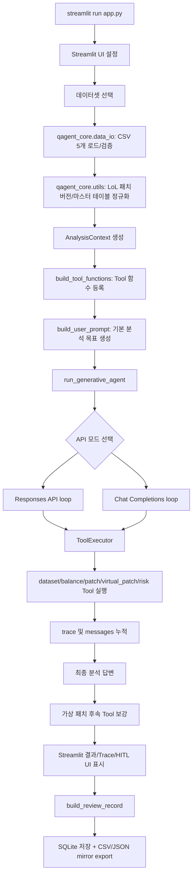

# QAgent Guidance

## Latest API/RAG/Guardrail Summary

The current implementation shares one Agent execution service between Streamlit UI and FastAPI. Before the LLM run, `qagent_core/guardrails.py` validates common UI/API inputs and `qagent_core/rag.py` retrieves project reference snippets for grounding.

New or important files:

- `api.py`: external `POST /api/agent/run` endpoint.
- `qagent_core/guardrails.py`: query/model/reasoning/context validation, prompt-injection signal detection, output secret masking.
- `qagent_core/rag.py`: lightweight file-based RAG over `README.md`, `docs/**/*.md`, `data/**/README.md`, `data/**/agent_prompt_v2.txt`, and `data/**/patch_notes.csv`.
- `docs/API.md`: endpoint request/response and error examples.
- `docs/RAG_GUIDE.md`: RAG retrieval targets, status values, and metadata.
- `docs/SECURITY_NOTES.md`: OWASP LLM Top 10 review and mitigations.
- `docs/AGENT_ARCHITECTURE.md`: LangChain, LangGraph, MCP, and A2A adoption decisions.

Additional environment variables:

- `AGENT_API_KEY`: external API authentication key, separate from `OPENAI_API_KEY`.
- `ENABLE_RAG`, `RAG_INCLUDE_DATA_DOCS`, `RAG_TOP_K`: file-based RAG settings.
- `MAX_AGENT_QUERY_CHARS`: shared UI/API query length guardrail.

API response metadata includes `rag_status`, `rag_sources`, `guardrail_warnings`, and `execution_nodes`.

## 1. 프로젝트 한 줄 요약

QAgent는 게임 전투 로그 CSV를 읽어 밸런스 이상 후보를 찾고, OpenAI Tool calling 기반 Agent가 패치 전후 변화, 세그먼트 영향, 관련 캐릭터/아이템/스킬/패치 근거, 가상 패치 후보, 재테스트 계획, Agent 자기반성을 생성한 뒤 Human-in-the-loop(HITL) 검토 기록으로 남기는 Streamlit 기반 PoC이다. 현재 구현은 실제 게임 서버에 패치를 적용하지 않으며, 가상 패치 영향은 예측 모델이나 게임 엔진 시뮬레이션이 아니라 통계/휴리스틱 기반 시나리오 추정이다.

## 2. 전체 프로젝트 구조

```text
QAgent/
├─ app.py
├─ requirements.txt
├─ .env.example
├─ README.md
├─ qagent_core/
│  ├─ agent/
│  ├─ data_pipeline/
│  ├─ review/
│  ├─ tools/
│  ├─ config.py
│  ├─ data_io.py
│  ├─ deadline.py
│  ├─ evaluation.py
│  ├─ persistence.py
│  ├─ risk.py
│  ├─ runtime.py
│  ├─ simulation.py
│  ├─ statistics.py
│  ├─ tool_executor.py
│  ├─ tool_registry.py
│  └─ utils.py
├─ data/
│  ├─ battle_logs.csv
│  ├─ characters.csv
│  ├─ skills.csv
│  ├─ equipment_sets.csv
│  ├─ patch_notes.csv
│  ├─ lol_assignment_dataset/
│  ├─ scenario_01_burst_meta/
│  ├─ scenario_02_stall_defense/
│  ├─ scenario_03_advanced_segment/
│  ├─ scenario_04_luna_vanguard/
│  ├─ human_review/
│  └─ riot_dataset/
├─ tests/
│  ├─ fixtures/
│  ├─ fakes.py
│  ├─ test_agent_evaluation.py
│  ├─ test_agent_loops.py
│  ├─ test_core.py
│  ├─ test_data_pipeline.py
│  ├─ test_prompts.py
│  └─ test_stabilization.py
├─ scripts/
│  ├─ check_encoding.py
│  ├─ profile_core.py
│  ├─ refresh_dataset_summary.py
│  └─ smoke_test_api.py
├─ docs/
│  ├─ guidance.md
│  ├─ RUN.md
│  ├─ PROJECT_STRUCTURE.md
│  ├─ SUBMISSION_NOTES.md
│  ├─ DELIVERY_CHECKLIST.md
│  ├─ evaluation/
│  ├─ performance/
│  └─ review/
├─ submission/
│  ├─ AI_AGENT_ARCHITECTURE.pdf
│  ├─ DEMO_SCENARIO.pdf
│  ├─ FINAL_PRESENTATION.pptx
│  ├─ FINAL_REPORT.pdf
│  └─ REFERENCES.pdf
├─ build_lol_assignment_dataset.py
├─ fetchMatch.py
├─ fetchPatches.py
└─ generateDemoData.py
```

| 영역 | 역할 |
|---|---|
| `app.py` | Streamlit UI 진입점. 데이터 선택, Agent 실행, Tool trace 표시, 가상 패치/HITL 검토 UI를 연결한다. |
| `qagent_core/` | Streamlit에 종속되지 않는 핵심 로직. 데이터 로딩, 통계, Tool, Agent loop, 저장소, 평가 로직이 들어 있다. |
| `qagent_core/agent/` | OpenAI Chat Completions/Responses API tool-calling 루프, 프롬프트, 후속 Tool 보강, trace 표시 로직. |
| `qagent_core/tools/` | Agent가 호출하는 분석 Tool 구현. 데이터 개요, 이상 후보 탐지, 패치 영향, LoL stat 계산, 가상 패치 등을 제공한다. |
| `qagent_core/review/` | HITL 검토 기록 생성/조회 orchestration. 실제 저장은 `persistence.py`의 SQLite repository를 사용한다. |
| `qagent_core/data_pipeline/` | Riot match 데이터 정규화 보조 함수. 네트워크/파일 I/O 없이 순수 변환 계약을 테스트한다. |
| `data/` | 앱이 읽는 CSV 데이터와 시나리오 데이터. `human_review/`, `riot_dataset/`은 실행/수집 결과 성격이다. |
| `tests/` | API 호출 없이 핵심 로직, Agent loop 계약, 평가 규칙, 데이터 파이프라인을 검증하는 unittest 테스트. |
| `scripts/` | API smoke test, 데이터 요약 재생성, 인코딩 검사, 성능 프로파일링 같은 유지보수 스크립트. |
| `docs/` | 실행/구조/평가/리뷰/성능 관련 문서. 일부 기존 문서는 현재 콘솔에서 인코딩이 깨져 보일 수 있어 코드 확인이 더 신뢰도 높다. |
| `submission/` | 제출용 PDF/PPT 산출물. 앱 실행에는 직접 필요하지 않다. |
| 루트 수집/생성 스크립트 | `fetchMatch.py`, `fetchPatches.py`, `generateDemoData.py`, `build_lol_assignment_dataset.py`는 데이터 수집/생성 보조 또는 레거시 성격이다. |

## 3. 핵심 실행 흐름

사용자가 `streamlit run app.py`로 앱을 실행하면 `app.py`가 Streamlit 화면을 구성한다. 사용자는 사이드바에서 OpenAI 모델/API 모드/분석 기준을 설정하고, 본문에서 데이터셋을 선택한다. 선택된 CSV 5개는 `qagent_core.data_io`와 `qagent_core.utils`를 거쳐 로드/정규화된다. 이후 `AnalysisContext`가 만들어지고, `qagent_core.tools.service.build_tool_functions()`가 Agent에게 제공할 Tool 함수 딕셔너리를 만든다.

Agent 실행 버튼을 누르면 `qagent_core.agent.service.run_generative_agent()`가 OpenAI client를 만들고 API 모드를 선택한다. Responses API 또는 Chat Completions loop는 모델이 선택한 tool call을 `ToolExecutor`로 실행한다. Tool 결과는 trace에 쌓이고, 최종 답변 생성 후 가상 패치 후속 Tool(`simulate_virtual_patch_impact`, `reflect_on_virtual_patch`)이 필요하면 보강 실행된다. 마지막으로 UI는 trace, 최종 분석, 가상 패치 자료, HITL 검토 폼을 표시하고, 사용자가 저장하면 SQLite와 CSV/JSON mirror에 검토 기록을 남긴다.



## 4. 주요 파일별 설명

| 경로 | 역할 | 주요 내용 | 수정 시 영향 |
|---|---|---|---|
| `app.py` | Streamlit 메인 앱 | UI, 데이터 선택, Agent 실행, 결과 표시, HITL 폼 | 화면 구성, 입력 옵션, 실행 흐름, 검토 UX 전체에 영향 |
| `requirements.txt` | Python 의존성 | `streamlit`, `pandas`, `openai`, `requests`, `python-dotenv` | 설치 환경과 실행 가능 패키지에 영향 |
| `.env.example` | 로컬 환경변수 템플릿 | OpenAI/Riot 키, 모델, API 모드, Agent/Tool 제한, 밸런스 탐지 threshold | 실행 기본값과 보안 설정 안내에 영향 |
| `README.md` | 최상위 안내 문서 | 빠른 실행, 기능, 테스트 명령, 데이터 구조 안내 | 사용자가 처음 보는 안내와 실제 코드가 어긋날 수 있음 |
| `qagent_core/config.py` | 설정 로딩 | `.env` 로드, 앱 버전, 모델/제한/threshold 기본값, secret 조회 | Agent 제한, 모델 기본값, 밸런스 후보 기준에 영향 |
| `qagent_core/data_io.py` | 데이터 로딩 계약 | 표준 CSV 5개, 필수 컬럼 검증, 폴더 탐색, 캐시 signature, 요약 생성 | 데이터 스키마, 로딩 실패 조건, 앱/테스트 데이터 계약에 영향 |
| `qagent_core/utils.py` | 공통 유틸리티 | LoL 패치 버전 매핑, 텍스트/숫자 정규화, DataFrame JSON 변환, LoL stat knowledge 검색 | 패치 버전 해석, Tool 출력 형식, LoL 관련 계산 보조에 영향 |
| `qagent_core/statistics.py` | 통계 분석 | win 판정 정규화, Wilson interval, binomial p-value, FDR, 이상 후보 탐지, 단계별 분석 | 밸런스 후보 선정 결과와 신뢰구간/유의성 해석에 영향 |
| `qagent_core/simulation.py` | 가상 패치 시나리오 계산 | win rate/damage/duration 휴리스틱 projection, conservative/baseline/aggressive 범위 | 가상 패치 영향 추정값과 경고 문구에 영향 |
| `qagent_core/risk.py` | 위험도/재테스트 정책 | risk score, risk level, recommended decision, segment별 retest plan | HITL 권고, 재테스트 규모, 위험 등급 산정에 영향 |
| `qagent_core/tool_registry.py` | Tool schema 단일 출처 | OpenAI function tool 이름, 설명, 파라미터 JSON schema | Agent가 호출 가능한 Tool 계약과 테스트 계약에 영향 |
| `qagent_core/tool_executor.py` | Tool 실행 정책 | JSON argument 파싱, 호출 수 제한, deadline/timeout, trace 기록, 에러 메시지 정규화 | 모든 Tool 호출의 안정성, trace, timeout 동작에 영향 |
| `qagent_core/runtime.py` | 런타임 안전 유틸 | run id 생성, 로그 redaction, 입력/출력 요약, 사용자 안전 에러 메시지 | 로그 보안, trace 표시, API/Tool 오류 메시지에 영향 |
| `qagent_core/deadline.py` | 실행 제한 보조 | 전체 Agent 실행 deadline과 요청 timeout 계산 | Agent/API/Tool timeout 일관성에 영향 |
| `qagent_core/tools/context.py` | Tool 공유 컨텍스트 | 5개 DataFrame을 담는 immutable dataclass | Tool 함수들이 어떤 데이터를 참조하는지에 영향 |
| `qagent_core/tools/service.py` | Tool 함수 조립 | dataset/balance/patch/virtual_patch Tool과 risk Tool 등록 | Agent가 실제 실행할 함수 목록에 영향 |
| `qagent_core/tools/dataset.py` | 데이터 개요 Tool | `get_dataset_overview`, `get_team_performance` | 데이터 개요/집계 결과와 Agent 초기 탐색에 영향 |
| `qagent_core/tools/balance.py` | 밸런스 분석 Tool | `detect_anomalies`, segment 분석, stat impact, adjustment options, LoL stat formulas | 이상 후보 탐지, 조정안 생성, LoL stat 설명/계산에 영향 |
| `qagent_core/tools/patch.py` | 패치 근거 Tool | patch별 성능 비교, 패치 impact, 관련 knowledge 검색 | 패치 전후 분석과 근거 검색 품질에 영향 |
| `qagent_core/tools/virtual_patch.py` | 가상 패치 Tool | virtual patch note, scenario estimate, self reflection | HITL 검토 대상인 가상 패치 자료와 자기반성 결과에 영향 |
| `qagent_core/tools/validators.py` | Tool 입력 검증 | 숫자 범위, choice, top_n 등 Tool 파라미터 검증 | 잘못된 Tool 입력의 처리 방식에 영향 |
| `qagent_core/agent/service.py` | Agent 진입점 | OpenAI client 생성, API 모드 선택, ToolExecutor 생성, loop 분기 | Agent 실행 방식, 모델/API 선택, 제한 정책에 영향 |
| `qagent_core/agent/responses.py` | Responses API loop | tool schema 변환, response text/call 추출, function_call_output 전송 | Responses API 사용 시 전체 Agent 동작에 영향 |
| `qagent_core/agent/chat_completions.py` | Chat Completions loop | message/tool_call 처리, tool 결과를 message로 반환 | Chat Completions 사용 시 전체 Agent 동작에 영향 |
| `qagent_core/agent/prompts.py` | Agent 프롬프트 | system prompt, 안전 정책, 데이터 프로필별 user prompt 생성 | Agent 행동, Tool 호출 순서, 최종 보고서 형식에 영향 |
| `qagent_core/agent/followup.py` | 후속 Tool 보강 | 가상 패치 note 이후 simulation/reflection Tool 누락 시 보강 | 최종 답변에 가상 패치 후속 분석이 포함되는지에 영향 |
| `qagent_core/agent/presentation.py` | trace 표시/요약 | Tool 표시명, live trace markdown, Tool 결과 요약 | UI의 실행 중 trace 가독성에 영향 |
| `qagent_core/review/service.py` | HITL 기록 orchestration | review id, artifact/log row 생성, virtual patch 결과 추출 | 검토 저장 데이터 구조와 표시 로그에 영향 |
| `qagent_core/persistence.py` | 저장소 구현 | SQLite repository, CSV append, JSON export, mirror 저장 정책 | HITL 저장 안정성, 중복 처리, export 방식에 영향 |
| `qagent_core/evaluation.py` | Agent 응답 평가 | fixture 기반 expected tool/금지 주장/필수 키워드/숫자 근거 검사 | API 없는 Agent 품질 회귀 테스트에 영향 |
| `qagent_core/data_pipeline/normalize_match.py` | Riot match 정규화 | Riot ID, patch version, queue, win, item, KDA 정규화 | Riot 수집 데이터를 앱 표준 스키마로 바꾸는 전처리에 영향 |
| `scripts/smoke_test_api.py` | 외부 API 연결 점검 | OpenAI model retrieve, Riot platform status 1회 요청 | 키/네트워크/모델 권한 사전 확인에 영향 |
| `scripts/refresh_dataset_summary.py` | 데이터 요약 재생성 | 현재 CSV 기준 `dataset_summary.json`, `app_conversion_summary.json` 갱신 | 제출 데이터 요약 문서와 실제 CSV 일치성에 영향 |
| `scripts/check_encoding.py` | 인코딩 검사 | `.py`, `.md` UTF-8 decode 및 mojibake 의심 패턴 검사 | 문서/코드 인코딩 품질 검증에 영향 |
| `scripts/profile_core.py` | 성능 측정 | 핵심 로직 wall-clock 프로파일링 | 성능 문서 갱신과 병목 확인에 영향 |
| `tests/test_core.py` | 핵심 로직 테스트 | data_io, statistics, ToolExecutor, persistence, Tool contract | 핵심 계약 회귀 방지에 영향 |
| `tests/test_agent_loops.py` | Agent loop 테스트 | fake OpenAI client로 Chat/Responses loop, timeout, call limit 검증 | API 없이 Agent loop 안정성 검증에 영향 |
| `tests/test_agent_evaluation.py` | Agent 품질 평가 테스트 | fixture 응답의 Tool/숫자/금지 주장/필수 문구 검증 | Agent 답변 품질 규칙에 영향 |
| `tests/test_data_pipeline.py` | Riot 데이터 정규화 테스트 | patch mapping, queue, item, KDA 등 순수 함수 검증 | Riot 데이터 전처리 호환성에 영향 |
| `tests/test_prompts.py` | 프롬프트 테스트 | prompt 계약 검증 | Agent 지시문 변경 안전성에 영향 |
| `tests/test_stabilization.py` | 안정화 테스트 | 확인 필요: 파일 내용은 별도 확인 필요 | 안정성 회귀 검증에 영향 |
| `fetchMatch.py` | Riot match 수집 스크립트 | 대형 루트 스크립트. 앱에서 직접 import하지 않는 레거시/수집 보조 성격 | Riot 원천 데이터 수집 방식에 영향 |
| `fetchPatches.py` | Riot/패치 데이터 수집 스크립트 | 패치 데이터 수집 보조 | 패치 원천 데이터 갱신에 영향 |
| `generateDemoData.py` | 데모 데이터 생성 | 샘플 데이터 생성 보조 | 기본/데모 CSV 생성에 영향 |
| `build_lol_assignment_dataset.py` | LoL 과제 데이터셋 생성 | LoL assignment CSV 생성/변환 보조 | `data/lol_assignment_dataset/` 생성 과정에 영향 |

## 5. 핵심 모듈 상세 설명

### UI

UI는 `app.py` 하나에 집중되어 있다. 주요 책임은 다음과 같다.

- 사이드바에서 OpenAI API key 원문은 받지 않고 설정됨/미설정 상태만 보여준다. 모델명, reasoning effort, API 모드, 밸런스 탐지 threshold는 UI에서 받는다.
- 데이터 입력 방식으로 기본 샘플, LoL 데이터셋, 폴더 자동 연결, CSV 직접 업로드를 제공한다.
- 데이터 로드 후 필수 battle log 컬럼을 확인하고, 데이터 미리보기와 컬럼 정보를 보여준다.
- `build_user_prompt()`로 기본 Agent 목표를 만들고 사용자가 편집할 수 있게 한다.
- Agent 실행 결과로 Tool trace, 최종 답변, 가상 패치 note, 가상 패치 영향 시나리오, Agent 자기반성을 표시한다.
- HITL 검토 폼을 통해 검토자, 상태, 위험도, 코멘트, 후속 조치, 담당자를 입력받고 저장한다.

UI 수정은 대부분 `app.py`에서 시작하면 된다. 다만 데이터 계약이나 Tool 결과 구조를 바꾸는 UI 변경은 `qagent_core`의 Tool/저장소/테스트까지 함께 봐야 한다.

### 데이터 로딩

데이터 로딩의 표준 계약은 `qagent_core/data_io.py`가 정의한다. 표준 데이터셋 폴더에는 다음 5개 CSV가 있어야 한다.

- `battle_logs.csv`
- `characters.csv`
- `skills.csv`
- `equipment_sets.csv`
- `patch_notes.csv`

각 CSV는 `REQUIRED_COLUMNS`에 정의된 필수 컬럼을 만족해야 한다. `app.py`는 Streamlit cache를 얹어 같은 로딩 함수를 사용하고, 이후 `qagent_core.utils.apply_lol_patch_version_mapping()`과 `normalize_master_tables()`로 LoL 패치 버전과 마스터 테이블을 정규화한다.

### Agent 실행

Agent 실행은 `qagent_core/agent/service.py`가 시작점이다. 핵심 흐름은 다음과 같다.

1. `run_generative_agent()`가 OpenAI client를 만든다.
2. `normalize_api_mode()`, `normalize_reasoning_effort()`, `choose_effective_openai_api()`로 API 모드를 정한다.
3. `build_system_prompt()`로 system prompt를 가져온다.
4. `ToolExecutor`를 생성해 전체 Tool call 수, timeout, trace 정책을 고정한다.
5. Responses API면 `responses.py`, Chat Completions면 `chat_completions.py`의 loop로 들어간다.
6. 모델이 요청한 function call을 `ToolExecutor.execute_raw()`가 파싱/검증/실행한다.
7. 모델이 최종 답변을 내면 `followup.py`가 가상 패치 후속 Tool 실행 누락을 보강할 수 있다.

### Tool 선택과 Tool 계약

Tool schema는 `qagent_core/tool_registry.py`의 `TOOL_SCHEMAS`가 단일 출처다. 실제 실행 함수 목록은 `qagent_core/tools/service.py`의 `build_tool_functions()`가 만든다. 테스트는 schema 이름과 실제 함수 이름이 일치하는지 확인한다.

현재 등록되는 Tool 범주는 다음과 같다.

- 데이터 개요/집계: `get_dataset_overview`, `get_team_performance`
- 이상 후보 탐지: `detect_anomalies`
- 패치/세그먼트 분석: `compare_patch_performance`, `analyze_patch_impact`, `analyze_segment_performance`
- 관련 지식 검색/LoL stat: `retrieve_related_knowledge`, `retrieve_lol_stat_knowledge`, `calculate_lol_stat_formulas`
- 영향/조정안: `simulate_stat_impact`, `calculate_adjustment_options`
- 위험도/재테스트: `assess_balance_risk`, `generate_retest_plan`
- 가상 패치/HITL 후보: `generate_virtual_patch_note`, `simulate_virtual_patch_impact`, `reflect_on_virtual_patch`

Tool을 추가할 때는 보통 Tool 구현, `build_tool_functions()`, `TOOL_SCHEMAS`, 테스트 fixture 또는 contract 테스트를 함께 수정해야 한다.

### 분석 로직

밸런스 후보 탐지의 핵심은 `qagent_core/statistics.py`다.

- 승리 판정은 `normalize_win_results()`가 담당하며, 공백/대소문자를 정규화한 `"win"`만 승리로 본다.
- `detect_balance_candidates()`는 patch/team/equipment/skill 조합을 집계하고 win rate, Wilson 95% interval, binomial upper-tail p-value, Benjamini-Hochberg FDR q-value를 계산한다.
- 후보 조건은 최소 표본 수, win rate threshold, 전체 평균 대비 win rate gap, Wilson lower bound gap, FDR alpha를 함께 본다.
- `analyze_balance_stages()`는 champion screening, patch reproducibility, segment check, item driver, final review candidate 형태로 단계별 요약을 만든다.

중요한 제한: 현재 데이터에는 pick rate/ban rate가 없다고 명시되어 있으며, 플레이어 숙련도/상대 조합/메타 변화 같은 교란변수를 완전히 통제하지 않는다.

### 보고서/결과 생성

Agent의 최종 분석 보고서는 모델이 작성하지만, 형식과 필수 내용은 `qagent_core/agent/prompts.py`가 강하게 유도한다. Tool 결과 표시와 live trace 요약은 `qagent_core/agent/presentation.py`가 맡는다. 가상 패치 note와 시나리오 데이터는 `qagent_core/tools/virtual_patch.py`의 구조화된 Tool 결과로 생성되며, 최종 UI와 HITL 저장에서 다시 사용된다.

### HITL 저장

HITL은 자동 승인 시스템이 아니다. `qagent_core/review/service.py`가 Agent state에서 최신 가상 패치/시뮬레이션/자기반성 결과를 뽑아 검토 record를 만들고, `qagent_core/persistence.py`가 SQLite를 권위 저장소로 사용한다. CSV와 JSON은 호환/내보내기 mirror이며, DB 저장 실패는 fatal, mirror 실패는 partial로 처리된다.

기본 저장 위치는 다음과 같다.

- SQLite: `data/human_review/reviews.sqlite3`
- CSV mirror: `data/human_review/review_logs.csv`
- JSON mirror: `data/human_review/records/*.json`

### 테스트

테스트는 `unittest` 기반이며 외부 API 호출 없이 대부분의 핵심 계약을 검증한다. Fake OpenAI client와 fixture를 사용하므로 CI나 로컬에서 API key 없이도 핵심 테스트가 가능하다.

## 6. 데이터와 설정

### 사용 데이터

| 위치 | 용도 |
|---|---|
| `data/*.csv` | 기본 샘플 데이터. `app.py`의 기본 샘플 모드에서 사용된다. |
| `data/lol_assignment_dataset/` | LoL assignment 데이터셋. 표준 CSV 5개와 summary JSON이 있다. |
| `data/scenario_01_burst_meta/` 등 | 시나리오별 CSV 세트와 `agent_prompt_v2.txt`. 폴더 자동 연결 모드에서 선택 가능한 데이터셋 후보가 될 수 있다. |
| `data/human_review/` | 앱 실행 중 HITL 검토 기록이 생성되는 위치. 로컬 실행 결과 성격이다. |
| `data/riot_dataset/` | Riot API 수집 원천/중간 결과 성격. 앱 기본 실행에는 필수 아님. |
| `tests/fixtures/` | Agent 평가 테스트용 고정 case와 Tool 결과. |

### 표준 CSV 계약

`qagent_core/data_io.py` 기준 필수 컬럼은 다음과 같다.

| CSV | 필수 컬럼 |
|---|---|
| `battle_logs.csv` | `battle_id`, `patch_version`, `player_team`, `enemy_team`, `result`, `duration_sec`, `main_dealer`, `total_damage`, `skill_used_most`, `equipment_set`, `user_segment`, `battle_mode` |
| `characters.csv` | `name`, `role`, `element`, `base_attack`, `base_hp`, `main_skill` |
| `skills.csv` | `skill_name`, `character`, `skill_type`, `damage_multiplier`, `cooldown_sec`, `effect` |
| `equipment_sets.csv` | `set_name`, `set_type`, `bonus_type`, `bonus_value`, `condition` |
| `patch_notes.csv` | `patch_version`, `date`, `change_target`, `before_value`, `after_value`, `description` |

### 환경변수

`.env.example`에는 다음 값이 정의되어 있다.

| 변수 | 필수 여부 | 기본/예시 | 설명 |
|---|---|---|---|
| `OPENAI_API_KEY` | Agent 실행 시 필수 | 빈 값 | 서버 내부 OpenAI 호출용 key. 앱 UI에 원문을 표시하거나 직접 입력받지 않는다. |
| `AGENT_API_KEY` | 외부 API 호출 시 필수 | 빈 값 | FastAPI endpoint 인증용 key. `OPENAI_API_KEY`와 분리한다. |
| `RIOT_API_KEY` | Riot 신규 수집/Smoke test 시 선택 | 빈 값 | Riot API key. 기본 CSV 분석에는 필요 없다. |
| `OPENAI_MODEL` | 선택 | `gpt-5.4` | Agent 실행 모델명. 모델 접근 권한은 별도 확인 필요. |
| `OPENAI_API_MODE` | 선택 | `responses` | `auto`, `responses`, `chat_completions` 중 하나. |
| `OPENAI_REASONING_EFFORT` | 선택 | `none` | `none`, `low`, `medium`, `high`, `xhigh` 등. 모델 지원 여부 확인 필요. |
| `MAX_AGENT_ITERATIONS` | 선택 | `18` | Agent loop 최대 turn. `config.py`에서 1~50으로 clamp. |
| `MAX_TOOL_CALLS` | 선택 | `30` | Tool call 최대 수. `config.py`에서 1~100으로 clamp. |
| `AGENT_TIMEOUT_SECONDS` | 선택 | `180` | 전체 Agent 실행 제한. `config.py`에서 10~1800초로 clamp. |
| `ENABLE_TOOL_TRACE` | 선택 | `true` | UI에서 Tool argument/result 상세 표시 여부. |
| `ENABLE_DEBUG_LOG` | 선택 | `false` | 오류 시 debug 정보 표시 여부. |
| `BALANCE_MIN_SAMPLES` | 선택 | `30` | 후보 탐지 최소 표본 수. |
| `BALANCE_MIN_WIN_RATE` | 선택 | `0.75` | 후보 win rate 기준. |
| `BALANCE_MIN_WIN_RATE_DIFF` | 선택 | `0.20` | 전체 평균 대비 win rate gap 기준. |
| `BALANCE_MIN_WILSON_DIFF` | 선택 | `0.0` | Wilson lower bound gap 기준. |
| `BALANCE_FDR_ALPHA` | 선택 | `0.05` | FDR q-value 기준. |

보안 주의: 실제 `.env`와 API key 파일은 커밋/제출 대상이 아니다.

## 7. 실행 방법

### 패키지 설치

```powershell
python -m venv .venv
.\.venv\Scripts\Activate.ps1
python -m pip install --upgrade pip
pip install -r requirements.txt
```

이미 `venv/`가 존재하지만, 새 환경을 만들 때는 기존 가상환경을 복사하지 말고 새로 설치하는 편이 안전하다.

### 환경변수 준비

```powershell
Copy-Item .env.example .env
```

`.env` 또는 배포 환경 Secret에 `OPENAI_API_KEY`를 넣는다. 앱 사이드바에서 OpenAI key 원문을 직접 입력하지 않는다. `RIOT_API_KEY`는 Riot 데이터를 새로 수집하거나 `scripts/smoke_test_api.py`에서 Riot 연결까지 확인할 때만 필요하다.

### Streamlit 앱 실행

```powershell
streamlit run app.py
```

실행 후 브라우저에서 Streamlit이 안내하는 로컬 주소로 접속한다.

실행 전 확인할 것:

- Python 패키지가 `requirements.txt` 기준으로 설치되어 있는가?
- 표준 CSV 5개가 선택한 데이터 폴더에 있는가?
- Agent 실행을 하려면 `OPENAI_API_KEY`가 있는가?
- 지정한 `OPENAI_MODEL`에 계정 권한이 있는가? 권한 확인은 `python scripts\smoke_test_api.py`로 할 수 있다.

### CLI/스크립트 실행

이 프로젝트의 주 실행 방식은 Streamlit이다. CLI성 보조 작업은 다음 스크립트로 수행한다.

```powershell
python scripts\refresh_dataset_summary.py
python scripts\smoke_test_api.py
python scripts\check_encoding.py
python scripts\profile_core.py
```

## 8. 테스트 및 검증 방법

### 전체 테스트

```powershell
python -m unittest discover -s tests -v
```

### 주요 개별 테스트

```powershell
python -m unittest tests.test_core -v
python -m unittest tests.test_agent_loops -v
python -m unittest tests.test_agent_evaluation -v
python -m unittest tests.test_data_pipeline -v
python -m unittest tests.test_prompts -v
python -m unittest tests.test_stabilization -v
```

### 문법/컴파일 검증

```powershell
python -m py_compile app.py fetchMatch.py fetchPatches.py build_lol_assignment_dataset.py generateDemoData.py scripts\refresh_dataset_summary.py
python -m compileall -q qagent_core tests
```

### 추가 검증

```powershell
python scripts\check_encoding.py
python scripts\smoke_test_api.py
```

`smoke_test_api.py`는 OpenAI 모델 조회와 Riot platform status API를 최대 1회씩 호출한다. 키가 없으면 해당 provider는 skip된다.

### 테스트가 검증하는 것

| 테스트 | 검증 내용 |
|---|---|
| `test_core.py` | 데이터 로딩/캐시 무효화, 통계, Wilson/FDR, ToolExecutor, SQLite/CSV/JSON 저장, Tool schema/function 일치 |
| `test_agent_loops.py` | Chat/Responses loop, fake client, tool call 순서, malformed argument, unknown tool, timeout, call limit |
| `test_agent_evaluation.py` | 고정 fixture 응답의 expected tool, 금지 주장, 필수 키워드, 제한 문구, 근거 없는 숫자 탐지 |
| `test_data_pipeline.py` | Riot ID, patch version mapping, queue, win, item id, KDA 정규화 |
| `test_prompts.py` | 프롬프트 계약. 세부 검증 항목은 파일 확인 필요 |
| `test_stabilization.py` | 안정화 계약. 세부 검증 항목은 파일 확인 필요 |

현재 문서 작성 과정에서는 테스트를 실행하지 않았다. 이 파일은 문서만 추가하므로 기능 변경은 없지만, 최종 제출 전에는 전체 테스트 명령을 실행하는 것이 좋다.

## 9. 자주 수정하게 될 파일

| 하고 싶은 일 | 먼저 볼 파일 | 함께 확인할 파일 |
|---|---|---|
| UI 문구/레이아웃/입력 옵션 변경 | `app.py` | `qagent_core/agent/presentation.py`, `qagent_core/config.py` |
| 데이터 선택 방식 변경 | `app.py` | `qagent_core/data_io.py`, `tests/test_core.py` |
| 표준 CSV 스키마 변경 | `qagent_core/data_io.py` | `app.py`, `qagent_core/tools/*`, `tests/test_core.py`, 실제 `data/*.csv` |
| Agent system prompt 변경 | `qagent_core/agent/prompts.py` | `tests/test_prompts.py`, `tests/fixtures/agent_eval_cases.json` |
| Agent API 모드/모델 선택 로직 변경 | `qagent_core/agent/service.py` | `qagent_core/agent/responses.py`, `qagent_core/agent/chat_completions.py`, `tests/test_agent_loops.py` |
| Tool 추가 | `qagent_core/tools/` 새 파일 또는 기존 파일 | `qagent_core/tools/service.py`, `qagent_core/tool_registry.py`, `tests/test_core.py` |
| Tool 입력 schema 변경 | `qagent_core/tool_registry.py` | 실제 Tool 함수 signature, `tests/test_core.py`, Agent prompt |
| 이상 후보 탐지 기준 변경 | `qagent_core/statistics.py`, `qagent_core/config.py` | `qagent_core/tools/balance.py`, `tests/test_core.py` |
| 패치 영향 분석 변경 | `qagent_core/tools/patch.py` | `qagent_core/utils.py`, `tests/test_core.py` |
| 가상 패치 note/시나리오 변경 | `qagent_core/tools/virtual_patch.py`, `qagent_core/simulation.py` | `qagent_core/agent/followup.py`, `app.py`, `tests/test_core.py` |
| 위험도/재테스트 정책 변경 | `qagent_core/risk.py` | `qagent_core/tools/service.py`, `tests/test_core.py` |
| HITL 저장 형식 변경 | `qagent_core/review/service.py`, `qagent_core/persistence.py` | `app.py`, `tests/test_core.py` |
| Riot 수집 데이터 정규화 변경 | `qagent_core/data_pipeline/normalize_match.py` | `fetchMatch.py`, `tests/test_data_pipeline.py` |
| 데이터셋 요약 갱신 | `scripts/refresh_dataset_summary.py` | `data/lol_assignment_dataset/dataset_summary.json` |
| 문서 수정 | `docs/` | `README.md`, 실제 코드와 테스트 |
| 최종 제출물 확인 | `submission/` | `docs/DELIVERY_CHECKLIST.md`, `docs/SUBMISSION_NOTES.md` |

## 10. 주의사항

- 구현된 기능과 미구현 기능을 구분해야 한다. 구현된 것은 CSV 기반 분석, OpenAI tool-calling Agent, Tool trace, 가상 패치 후보 생성, 휴리스틱 시나리오 추정, HITL 저장이다.
- 미구현 또는 PoC 제한 사항: 실제 게임 서버 패치 적용, 실제 예측 모델, 게임 엔진 시뮬레이션, 중앙화된 운영 DB, 사용자 인증/권한, CI/CD, 운영 모니터링은 현재 코드상 구현되어 있지 않다.
- 가상 패치 영향은 `qagent_core/simulation.py`의 단순 bounded heuristic 계산이다. 모델 예측이나 실제 QA 결과처럼 해석하면 안 된다.
- `detect_anomalies` 결과는 밸런스 이상 “확정”이 아니라 추가 검토 후보이다. Wilson interval과 FDR을 사용하지만 pick/ban, 숙련도, 상대 조합, 메타 변화 등은 완전히 통제하지 않는다.
- `OPENAI_MODEL` 기본값은 `.env.example`과 `config.py` 기준 `gpt-5.4`지만, 실제 사용 가능 여부는 계정/시점별 권한에 따라 달라질 수 있다. `scripts/smoke_test_api.py`로 확인해야 한다.
- `RIOT_API_KEY`는 기본 CSV 분석에는 필요 없고 신규 수집/연결 확인에만 필요하다.
- `data/human_review/`는 실행 중 생성되는 개인 검토 기록을 포함할 수 있다. 제출/공유 시 주의해야 한다.
- 기존 `README.md`와 일부 `docs/*.md`는 현재 터미널 출력에서 한글 인코딩이 깨져 보인다. 코드와 테스트를 우선 근거로 삼고, 문서 내용은 필요 시 인코딩 상태를 확인해야 한다.
- `fetchMatch.py`, `fetchPatches.py`, `generateDemoData.py`, `build_lol_assignment_dataset.py`는 앱 실행 흐름의 직접 import 대상이 아니다. 데이터 수집/생성 보조 또는 레거시 성격으로 보는 것이 안전하다.
- Tool schema와 실제 함수 이름은 테스트가 일치성을 검증한다. Tool을 추가하거나 이름을 바꿀 때 둘 중 하나만 수정하면 Agent 호출이 실패할 수 있다.
- `ToolExecutor`는 timeout된 Python thread를 항상 강제 종료할 수 있는 구조가 아니다. timeout 결과가 반환되어도 underlying task가 나중에 완료될 수 있다는 경고를 결과에 포함한다.

## 11. 용어 정리

| 용어 | 의미 |
|---|---|
| Agent | OpenAI 모델이 목표를 읽고 Tool을 선택/호출하며 최종 분석 보고서를 생성하는 실행 주체. |
| Tool | Agent가 호출할 수 있는 Python 함수. 데이터 요약, 이상 후보 탐지, 패치 분석, 가상 패치 생성 등을 수행한다. |
| Tool schema | OpenAI에 전달하는 function calling 계약. 이름, 설명, 입력 파라미터 JSON schema를 포함한다. |
| ToolExecutor | 모든 Tool 호출을 감싸는 실행 계층. JSON 파싱, timeout, call limit, trace, 에러 처리를 통일한다. |
| Trace | Agent 실행 중 어떤 Tool을 어떤 입력으로 호출했고 어떤 결과가 나왔는지 저장한 실행 기록. |
| HITL | Human-in-the-loop. Agent 제안을 자동 적용하지 않고 사람이 검토/승인/반려/재테스트 판단을 남기는 단계. |
| Patch impact | 특정 패치 버전 전후로 win rate, damage, duration 등이 어떻게 변했는지 비교하는 분석. |
| Virtual patch | 실제 패치가 아니라 Agent가 제안하는 후보 패치 note. Human Review 전까지는 적용되지 않는다. |
| Scenario estimate | 가상 패치가 적용됐다고 가정할 때의 휴리스틱 기반 win rate/damage/duration 변화 추정. |
| Reflection | Agent가 자신의 가상 패치 제안에 대해 표본 부족, 과조정 위험, 추가 검증 필요성을 자체 점검하는 단계. |
| Wilson interval | 비율 추정의 신뢰구간 계산 방식. 작은 표본에서 단순 win rate보다 보수적인 후보 판단에 도움을 준다. |
| FDR | False Discovery Rate. 여러 후보를 동시에 비교할 때 우연히 발견된 것처럼 보이는 결과를 줄이기 위한 보정. |
| `player_team` | 샘플 RPG에서는 팀 조합, LoL 데이터에서는 챔피언명처럼 사용될 수 있는 핵심 분석 단위. |
| `equipment_set` | 샘플 RPG에서는 장비 세트, LoL 데이터에서는 대표 아이템처럼 사용되는 분석 단위. |
| `skill_used_most` | 샘플 RPG에서는 주 사용 스킬, LoL 데이터에서는 포지션/스킬 유사 분석 단위로 사용된다. |

## 12. 빠른 탐색 가이드

| 목적 | 어디부터 볼 것인가 |
|---|---|
| 전체 개요를 보고 싶다면 | 이 문서와 `README.md`, `docs/PROJECT_STRUCTURE.md` |
| 실행만 해보고 싶다면 | `docs/RUN.md`, `.env.example`, `requirements.txt`, `app.py` |
| 앱 화면 흐름을 이해하고 싶다면 | `app.py`의 UI 섹션과 `qagent_core/agent/service.py` |
| 데이터 계약을 확인하고 싶다면 | `qagent_core/data_io.py`, `data/lol_assignment_dataset/README.md`, 실제 CSV 헤더 |
| Agent 로직을 보고 싶다면 | `qagent_core/agent/service.py`, `responses.py`, `chat_completions.py`, `prompts.py` |
| Tool 목록을 보고 싶다면 | `qagent_core/tool_registry.py`, `qagent_core/tools/service.py` |
| 이상 후보 탐지 로직을 보고 싶다면 | `qagent_core/statistics.py`, `qagent_core/tools/balance.py` |
| 패치 영향 분석을 보고 싶다면 | `qagent_core/tools/patch.py`, `qagent_core/utils.py` |
| 가상 패치/HITL을 보고 싶다면 | `qagent_core/tools/virtual_patch.py`, `qagent_core/review/service.py`, `qagent_core/persistence.py` |
| UI를 수정하고 싶다면 | `app.py` |
| 테스트를 확인하고 싶다면 | `tests/test_core.py`, `tests/test_agent_loops.py`, `tests/test_agent_evaluation.py` |
| API 연결을 확인하고 싶다면 | `scripts/smoke_test_api.py` |
| 데이터 요약을 갱신하고 싶다면 | `scripts/refresh_dataset_summary.py` |
| 최종 제출물을 확인하고 싶다면 | `submission/`, `docs/SUBMISSION_NOTES.md`, `docs/DELIVERY_CHECKLIST.md` |

## 구현 기능과 향후 개선 아이디어

### 현재 구현된 기능

- Streamlit 기반 앱 UI
- 표준 CSV 5개 로딩/검증
- LoL 패치 버전 매핑과 마스터 테이블 정규화
- 데이터 개요와 팀/아이템/스킬/패치 단위 집계
- Wilson interval, binomial p-value, FDR 기반 밸런스 후보 탐지
- 패치 전후 성능 비교와 segment 분석
- 관련 캐릭터/스킬/장비/패치 note 검색
- LoL stat knowledge 검색과 기본 stat formula 계산
- OpenAI Chat Completions/Responses API tool-calling loop
- Tool call trace, timeout, call limit, 안전 로그 redaction
- 가상 패치 note, 휴리스틱 시나리오 추정, Agent self-reflection
- HITL 검토 기록 SQLite 저장 및 CSV/JSON mirror export
- API 없는 unit test와 fixture 기반 Agent 평가

### 향후 개선 아이디어 또는 운영화 필요 항목

- 사용자 인증/권한과 reviewer identity 관리
- 중앙 DB(PostgreSQL 등) 기반 HITL 감사 저장소
- Secret Manager 또는 배포 플랫폼 secret 연동
- CI/CD, 컨테이너 배포, 운영 모니터링
- 실제 게임 QA 결과 또는 A/B test 데이터 연결
- pick rate, ban rate, 상대 조합, 숙련도, 메타 변화 등 추가 교란변수 반영
- 실제 예측 모델 또는 게임 엔진 기반 simulation
- Tool 결과와 Agent 최종 답변의 더 강한 숫자 근거 검증
- 데이터셋 버전/계보/수집 시점 관리

## 작성 시 참고한 주요 파일

- `rg --files` 결과 전체
- `README.md`
- `requirements.txt`
- `.env.example`
- `docs/RUN.md`
- `docs/PROJECT_STRUCTURE.md`
- `docs/SUBMISSION_NOTES.md`
- `docs/DELIVERY_CHECKLIST.md`
- `docs/evaluation/AGENT_EVALUATION.md`
- `app.py`
- `qagent_core/config.py`
- `qagent_core/data_io.py`
- `qagent_core/runtime.py`
- `qagent_core/tool_registry.py`
- `qagent_core/tool_executor.py`
- `qagent_core/statistics.py`
- `qagent_core/simulation.py`
- `qagent_core/risk.py`
- `qagent_core/persistence.py`
- `qagent_core/evaluation.py`
- `qagent_core/tools/context.py`
- `qagent_core/tools/service.py`
- `qagent_core/tools/dataset.py`
- `qagent_core/tools/balance.py`
- `qagent_core/tools/patch.py`
- `qagent_core/tools/virtual_patch.py`
- `qagent_core/agent/service.py`
- `qagent_core/agent/responses.py`
- `qagent_core/agent/chat_completions.py`
- `qagent_core/agent/prompts.py`
- `qagent_core/review/service.py`
- `qagent_core/data_pipeline/normalize_match.py`
- `scripts/smoke_test_api.py`
- `scripts/refresh_dataset_summary.py`
- `scripts/check_encoding.py`
- `tests/test_core.py`
- `tests/test_agent_loops.py`
- `tests/test_agent_evaluation.py`
- `tests/test_data_pipeline.py`

## 자체 점검 체크리스트

- [x] `guidance.md`만 읽어도 프로젝트 구조를 이해할 수 있도록 주요 폴더, 실행 흐름, 데이터 계약을 설명했다.
- [x] 파일별 역할을 실제 코드에서 확인한 내용과 맞춰 작성했다.
- [x] 구현된 기능과 향후 개선 아이디어를 별도 섹션으로 분리했다.
- [x] 실행 방법과 테스트 방법을 현재 프로젝트의 `requirements.txt`, `.env.example`, `tests/`, `scripts/` 기준으로 작성했다.
- [x] 처음 보는 사람이 UI, Agent 프롬프트, Tool, 데이터 스키마, HITL 저장, 문서 중 무엇을 수정해야 하는지 찾을 수 있도록 안내했다.
- [x] 추측이 필요한 부분은 “확인 필요”로 표시했다.
- [x] 기존 코드나 다른 문서는 수정하지 않고 `docs/guidance.md`만 생성했다.
